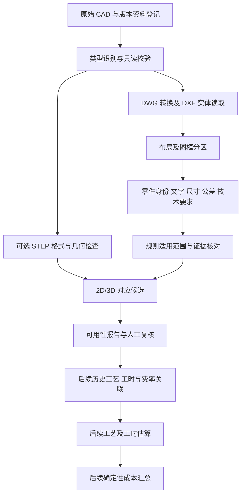

# 模具零部件加工成本评估：项目理解

编写日期：2026-10-14（北京时间）。当前阶段：需求理解与 CAD 数据探查设计，不新增分析代码或完整 Agent。

## 依据与事实边界

本次实际读取的是 `doc/模具零部件加工成本评估需求说明.pdf` 与 `doc/customer_requirement.md`；用户提供的 `docs/` 路径当前不存在。PDF 共 5 页，文本内容及第 3 页技术路线图均已查看。客户原始需求保持不变。

- PDF 第 2 页：批量输入 DWG 和可能存在的 STP，快速输出零部件预估加工成本。
- PDF 第 3 页：2D 必须提供、3D 可选；缺少 3D 时设想通过工程制图 Agent 生成；2D/3D 匹配度达到 90% 才进入后续流程，否则提交人工处理；按工艺分发到不同工时评估角色并汇总成本。
- PDF 第 4 页：客户称可提供历史图纸、人工编排的正确工艺/工序、各工序实际工时及工时成本。这里只确认提供意愿，尚未收到或验证这些数据。
- `customer_requirement.md`：客户描述一般公差变更导致核价错误，并提出测试包含 179 个零件的历史模具图纸。
- 当前目录及既有清单：13 个原始文件，7 个 DWG、6 个 STP；179 是客户描述的零件数，尚未通过图框分区验证。

以下将客户事实、技术判断和待确认事项区分表述。客户文档末尾“有23D对应”表述不完整，不能据此断定全部图纸都有 3D。

## 1. 客户业务痛点

客户最直接的痛点是核价工程师遗漏了图框中的一般公差变更。案例中绘图区保持一致，两位小数尺寸适用的公差从 ±0.002 改为 ±0.01，仍按历史要求核价 1200 元，客户称正确价格应为 500 元，单个零件多付 700 元。金额来自客户陈述，本次未核验订单或工艺记录；也不能据此推导普遍的公差与价格换算公式。

这意味着系统需要同时理解几何、加工要求及图纸版本：同一形状可能因公差、材料、热处理、表面要求或检验要求不同而产生不同工序和工时。一般公差藏在图框或技术说明中，只比较几何会漏掉关键变更。

客户还有批量核价与交付速度诉求。179 个零件的大图增加了人工分图、辨识和核对负担。历史工艺与实际工时可能成为估算依据，但必须先验证记录是否能关联到正确的零件、图纸版本和加工条件。

技术判断：优先交付可复核的图纸要求提取与版本变更识别，有望先解决已知漏判；是否能稳定自动报价，需要 CAD 与历史生产数据共同验证。

## 2. 输入数据类型

| 输入 | 客户描述/当前事实 | 预期用途 | 主要待验证项 |
| --- | --- | --- | --- |
| 2D DWG | 客户要求必须提供；当前 7 个文件 | 尺寸、一般公差、明确公差、技术要求、图框、版本 | 转换保真、文字可读性、多零件布局、单位、外参 |
| 2D DXF | 当前没有；作为 DWG 转换或客户导出的中间格式 | 结构化实体提取 | 是否保留中文、属性、尺寸样式、外参和全部布局 |
| 3D STP/STEP | 客户描述可选；当前 6 个 STP | 几何与拓扑分析、辅助确认 2D/3D 对应 | 单位、坐标、实体有效性、版本一致性、是否包含 PMI |
| 历史人工工艺/工序 | PDF 声称可提供，未收到 | 工艺候选、规则核对、后续训练/评测 | 编码统一、顺序、设备、版本、审核结果 |
| 历史实际工时 | PDF 声称管理系统中存在，未收到 | 工时基线与后续估算模型 | 单件/批次口径、准备/加工/检验拆分、停机和返工 |
| 工序工时成本 | PDF 声称可以导出，未收到 | 工时转换为成本 | 币种、单位、有效期、设备/人工包含范围 |
| 版本对照与核价记录 | 本次技术判断建议补充 | 公差变更与成本回归验证 | 是否有案例的旧/新原图及核价依据 |

材料、毛坯、数量、设备能力、外协和检验要求是潜在必要输入，不能假定客户已经提供。

## 3. 输出目标

客户最终明确要求的是“零部件预估加工成本”。PDF 的路线还包含工序工时汇总与加工费用计算。

建议最终输出能够定位到零件及版本，列出加工要求、候选工艺路线、逐工序工时、费率、分项成本和合计；同时保存计算依据、缺失字段、估算区间及人工复核状态。以上解释性字段是技术设计建议，需客户确认。

成本计算应由确定性规则完成。若费率按元/小时计、工时按小时计，基础关系为“各工序工时 × 对应费率”的合计；准备时间如何分摊、材料和外协是否计入、税费及利润是否计入，目前不能确定。单件成本与批量总成本必须分别定义。

第一阶段输出是 CAD 可用性报告、文件清单、结构化字段与证据、缺失项和错误清单，不输出未经验证的报价。报告应回答：哪些字段可可靠获得，哪些需要转换、人工标注或补充数据，现有样本是否支持下一阶段。

## 4. 预期 Agent 角色

这些是客户长期设想中的职责，不代表当前需要部署多个自治 Agent。

| 角色 | 来源 | 预期职责 | 验证要求 |
| --- | --- | --- | --- |
| 工程制图 Agent | PDF 第 3/4 页 | 缺少 3D 时从 2D 生成候选 3D | 多视图约束、尺寸一致、人工确认；无法唯一确定时保留歧义 |
| 图纸匹配角色 | PDF 第 3 页 | 建立 2D/3D 对应，低于阈值交给人工 | 定义匹配指标和评测集；不能把模型自述概率直接当匹配度 |
| 工艺工程 Agent | PDF 第 3/4 页 | 解析要求，提出工艺与工序并分发 | 设备能力、材料、热处理、工序顺序与公差保障 |
| 磨床/CNC/线切割工时评估角色 | PDF 第 3 页 | 按对应工序估算工时 | 工艺与设备条件一致的历史数据、实际工时误差 |
| 质量检测工时评估角色 | PDF 第 3 页 | 估算检验/检测工时 | 检验项目、精度、抽检比例和批量口径 |
| 成本汇总角色 | PDF 第 3/4 页 | 汇总工时和费用 | 费率有效期、单位与计算过程可追溯 |
| 人工核价/工艺审核 | PDF 第 3 页人工分支，职责为技术补充 | 确认歧义、异常和报价 | 有明确的复核触发条件与审核记录 |

更合理的实现起点是可测量的任务模块与人工确认流程。CAD 读取、规则检查和成本算术由工具处理；是否引入 LLM、如何划分 Agent，应由数据与验证结果决定。

## 5. 技术路线分析

### 客户路线及其关键假设

客户路线为“2D 输入 → 可选 3D 生成 → 2D/3D 匹配 → 工艺与工序 → 分工序工时 → 成本汇总”。它假设 2D 信息足够重建 3D、图纸版本可匹配、工艺记录与工时数据可用于估算。当前没有证据证明这些假设在本数据集成立。

### CAD 结构化提取与图面核对

优先读取 CAD 实体、属性与尺寸数据，并用渲染后的图面核对，补充处理炸开文字、扫描嵌图等情况。DWG 当前需要转换器或客户导出的 DXF；转换后的实体可读不等于制造语义完整，需要针对图框、一般公差、尺寸和符号抽检。[ezdxf 官方转换说明](https://ezdxf.readthedocs.io/en/stable/addons/odafc.html)

公差提取需同时关注一般公差表、明确标注公差、尺寸样式与单尺寸覆盖值。ezdxf 文档说明尺寸样式可在具体 DIMENSION 上覆盖，因此只提取显示文字或样式名称不足以恢复全部要求。[尺寸样式与覆盖说明](https://ezdxf.readthedocs.io/en/stable/tutorials/linear_dimension.html)

### 3D 的作用与边界

已有 STP 的样本先验证几何和版本，再研究尺寸/要求与 3D 特征的对应。纯 2D 样本应先评估直接提取制造要求和有限特征的可行性，将自动 3D 重建单独作为验证课题。视图、剖面或尺寸约束不足时，多个模型都可能符合图纸，不能默认自动生成结果正确。

PDF 称“3D 图档中无加工公差”，应理解为客户现有数据的描述。STEP 格式也可能承载尺寸与公差 PMI，需检查实际文件内容。[Open Cascade 官方支持范围](https://www.opencascade.com/products/cad-assistant/)

### 工艺、工时与成本

待历史数据对齐后，先建立可解释基线，例如相似零件检索、经过审核的工艺规则和按工序统计的工时基线，再比较学习模型是否改善误差。现有几何数量不能直接映射为加工难度或成本。

工序通常有先后关系和准备时间，不宜假设各工时角色可独立估算后直接相加而无协调。训练/评测应避免相同零件家族或相邻版本同时进入训练与测试造成泄漏。

技术判断：当前优先级为公差与版本完整性、零件分区、字段可用性及历史数据关联。多 Agent、完整 3D 重建与自动报价留到验证条件成熟后。

## 6. 可能的数据处理流程

每步保留来源文件哈希、转换/解析版本、实体标识、布局、坐标或图面证据。无法获取的值保持未知，冲突或不完整记录转人工。第一阶段止于可用性报告与人工复核。

## 7. 当前需求中不明确的问题

| 优先级 | 待确认问题 | 对方案的影响 |
| --- | --- | --- |
| P0 | 首个试点优先解决公差变更漏判，还是承诺端到端报价？ | 决定交付边界与验收方式 |
| P0 | “加工成本”是否含毛坯、材料、热处理、外协、检验、准备、损耗、管理费、利润及税？ | 定义成本口径 |
| P0 | 能否提供公差案例的旧/新原图、单位、审核工艺和核价记录？ | 建立最直接的回归样例 |
| P0 | 一般公差的适用范围和明确公差的优先级如何规定？尺寸小数位依据显示形式还是实际值？ | 防止把 10.00 与 10.0 归入错误规则 |
| P0 | 历史工艺、工时和费率能否按零件号、图纸版本、设备及日期关联？ | 判断后续估算数据是否成立 |
| P0 | 单件/批次工时、准备时间分摊和返工/停机口径是什么？ | 避免标签和金额偏差 |
| P1 | 大图中 179 个对象是零件、图框还是视图？如何识别零件及版本？ | 决定分区标注与统计口径 |
| P1 | 6 对同名 DWG/STP 是否确为同一零件及同一版本？与大图是否重合？ | 防止重复样本与错配 |
| P1 | PDF 的 90% 匹配度具体是几何覆盖、特征对应、评分还是概率？ | 定义人工分支阈值及可靠性 |
| P1 | CAD 软件/版本、图层规范、字体、外参、材料标准与制图单位是什么？ | 决定读取环境与字段解释 |
| P1 | 工艺范围及设备能力有哪些？是否必须覆盖铣削、磨削、线切割以外工艺？ | 决定工艺与工时模型边界 |
| P1 | 成本误差、关键字段漏检、单批时延、人工复核率和试点样本如何验收？ | 避免只用少量演示判断成功 |
| P2 | 部署环境、数据授权、模型/API 使用范围、权限和审计要求是什么？ | 决定系统部署与数据访问 |

这些问题不妨碍当前只读探查，但公差规则、版本和成本口径未确认前，不应将系统输出作为自动核价依据。

## 8. 后续 CAD 数据分析关注字段

| 字段组 | 关注字段 | 目的/取值规则 |
| --- | --- | --- |
| 来源与版本 | source_hash、文件名、真实类型、CAD 版本、解析器/转换器版本、时间、错误 | 复现与追溯；文件名仅是身份候选 |
| 布局与分区 | layout、图框边界、视图/剖面区域、块路径、插入变换、外参 | 建立文件→图框→零件→视图关系 |
| 零件身份 | 图号、名称、版本、修订日期、数量、材料、与 3D 的对应 | 关联工艺和历史数据；冲突需保留 |
| 原始文字证据 | 原始/规范化文字、实体类型/handle、坐标、图层、块实例、字体、提取方法 | 对照图面；无坐标时无法可靠判断归属 |
| 一般公差 | 原文、单位、小数位/范围条件、上下限、适用对象、标准、例外 | 重点识别图框变更；保留规则来源 |
| 尺寸及明确公差 | 标称值原文、小数位、数值、单位、尺寸类型、覆盖文本、样式/覆盖值、上/下偏差、关联实体 | 不丢弃小数位；区分显示值、几何值和计算值 |
| 其他制造要求 | 形位公差、基准、粗糙度、热处理/硬度、表面处理、技术说明 | 区分明示值、缺失值与推断值 |
| 2D 几何 | entity/layer/block 统计、曲线端点、半径、包围盒、单位、尺度 | 为分区与特征候选提供证据；实体数不等于特征数 |
| 3D 几何 | schema、单位、实体/装配、有效性、包围盒、面积/体积、面类型、孔槽候选、PMI | 先进行 CAD 内核验证，再解释制造特征 |
| 变更关系 | old/new 版本、几何/图框/公差差异、变更区域、审核状态 | 识别同几何不同要求的案例 |
| 质量与证据 | 缺失、冲突、外参缺失、乱码、提取状态、方法、人工确认 | 把未知与真实零值区分；未经校准的评分不当作概率 |

优先级：先验证图框身份、一般公差、明确尺寸、公差原文和版本；再验证材料/工艺要求及几何特征。历史工时与费率在独立表中通过身份和版本关联，不从 CAD 中臆测。
