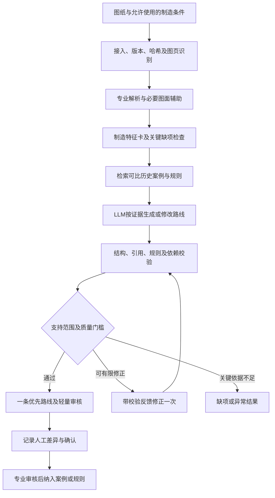

# 工艺路线智能推荐模块：开发任务与技术实现方案

编制日期：2026年10月28日  
适用项目：模具零部件智能加工成本评估系统  
文档用途：开发交接、技术实现、试验评价及阶段验收依据  
现有项目根目录：`/home/gxl/code/cad-cost-estimation`

## 1. 任务定义与产品要求

### 1.1 本次开发什么

开发一个从模具零部件CAD图纸出发，结合历史加工案例、制造规则和大语言模型，自动形成加工工艺路线建议的模块。

主要输入为零件图纸及必要的制造条件，主要输出为一条优先推荐的工艺路线，包含工序代码、名称、顺序或依赖、适用依据和风险。存在实质性选择时，可附少量备选路线。

本模块面向“AI完成主要分析，工程师通常只作少量修改”的工作方式。开发目标包括减少关键工序遗漏、提高路线适用性、降低人工修改量，而不仅是生成语句流畅的工艺说明。

本轮交付的是该模块及必要的轻量接口、审核与评测能力，不要求同时开发完整成本系统、复杂多Agent平台或企业级工艺管理系统。

### 1.2 与此前人工审核定位的变化

| 维度 | 本模块要求 |
| --- | --- |
| 初稿责任 | AI需要完成可供采用的主要工艺组织，不能把大部分工序留空让工程师编制 |
| 日常人工工作 | 优先集中在核对关键项、修改非关键参数及确认结果 |
| 质量评价 | 将“少量修改即可采用”的比例及覆盖率列为核心指标 |
| 失败处理 | 缺少关键依据或存在未解决冲突时，返回明确异常和缺项，进入少数异常任务处理 |
| 业务结果 | 区分模型建议、系统校验结果和业务确认，保留最终责任及授权流程 |

人工只能微调，提高了对输入完整性、案例质量、规则覆盖和首稿质量的要求。实现上需要收窄首期适用范围，并设置异常出口。不能用模型自报高置信度代替制造验证，也不能把无依据的完整路线当作正常结果交付。

### 1.3 首期定位

采用“专业CAD解析＋结构化制造案例库＋检索增强＋经审核规则＋LLM候选生成＋确定性校验”的技术路线。

首期优先支持已选定的模具类别、零件家族、图纸模板和工序范围。具体家族及规则由项目负责人和工艺专家在启动阶段确定。现有数据可以启动开发，但尚无证据表明多数新零件已经能达到低编辑量采用要求；该目标必须通过独立评测验证。

### 1.4 本轮不包含

- 从零训练“任意CAD到完整工艺路线”的通用模型。
- 将现有历史路线直接视为最优路线，或自动证明其生产可执行性。
- 任意二维图自动重建完整三维、生成刀路或机床NC代码。
- 实际加工工时精准预测、自动确定设备费率及完整报价。
- 无人审核的生产工艺发布、对外报价放行或设备执行。
- 首期强制多Agent协作、独立向量数据库或大型图数据库。

工时定额作为历史参考保留，成本计算可以在后续调用本模块的已确认路线。工时和成本不是本轮路线推荐验收的替代指标。

## 2. 同事接手后的第一步

### 2.1 阅读顺序

1. 本文档。
2. `README.md`：现有环境、入口及数据保护方式。
3. `doc/customer_requirement.md`和`doc/模具零部件加工成本评估需求说明.pdf`：原始业务诉求。
4. `doc/机加图档工艺工时说明.pptx`：两类模具、工序顺序及电极关系。
5. `reports/manufacturing_data_analysis.md`。
6. `reports/cad_process_matching_report.md`。
7. `reports/dxf_deep_analysis.md`。
8. `reports/business_requirement_support_matrix.md`：各功能与数据支持关系。

最终Word方案、会议问题清单及甲方确认记录作为交接附件补充。编写时当前目录未发现此前的`reports/模具零部件智能加工成本评估系统_需求分析与技术方案2.docx`和`reports/甲方方案沟通会议_待确认问题清单.md`，接手时应由项目负责人另外提供或明确以本文及现有资料为基线，不将这两个路径作为运行依赖。尚未取得甲方答复的问题不能默认为已经确定。

### 2.2 Git与数据交接注意事项

**当前`.gitignore`忽略`data/raw/`和`data/processed/`。只克隆新建Git仓库，不会自动得到CAD、Excel及分析JSON。**

建议交接方式：

1. 私有Git仓库存代码、依赖、文档和不含客户资料的测试样例。
2. 通过获准的内部渠道提供客户资料包，至少包含本文第3节所列原始资料和现有结构化结果。
3. 提供资料包清单，记录项目相对路径、文件大小、SHA-256、数据快照编号及使用授权范围。
4. 接手人员将资料恢复到相同的项目相对路径，核对清单后导入。
5. `.venv/`和`.env`不交入Git；同事在本机重建环境。模型密钥不写入源码或样例。

是否将部分客户数据纳入私有Git或Git LFS，需由项目的数据管理方式确定；本次开发不默认修改忽略规则，也不使用`git add -f`绕过规则。

核对时，原始资料与历史分析快照分别登记。`source_integrity.json`记录的是此前82份输入的历史校验，不涵盖今后新增的全部文件；新资料包必须另建当前清单。

### 2.3 环境启动

现有运行环境为WSL Ubuntu、Python 3.10、项目`.venv`。Windows和WSL虚拟环境不能混用。

```bash
cd /path/to/cad-cost-estimation
python3 -m venv .venv
.venv/bin/python -m pip install -r requirements-dev.txt
.venv/bin/python -m pytest -q
```

`requirements-dev.txt`已经包含`requirements.txt`。缺少客户原始数据时，部分数据回归测试会跳过；不能只看到测试通过就判断交接数据完整，必须核对跳过原因和资料清单。

### 2.4 现有依赖与新依赖

| 依赖／工具 | 当前用途 | 本模块处理方式 |
| --- | --- | --- |
| ezdxf 1.4.4 | DXF实体、文字、尺寸、块读取 | 优先复用 |
| xlrd 2.0.2 | 旧版`.xls`读取 | 优先使用现有JSON，需要复现时复用读取器 |
| openpyxl 3.1.5 | `.xlsx`分类字典读取 | 同上 |
| python-pptx 1.0.2 | PPT文字、表格及图形关系提取 | 使用已有结果及原PPT核验 |
| python-dotenv 1.1.1 | 环境配置 | 复用 |
| Python标准库 | JSON、统计、哈希、日志、图结构等 | 复用；原型数据存储可用sqlite3 |
| ODA File Converter | DWG转DXF | 独立外部软件，不能靠安装Python包代替 |

开发时可增加Pydantic等结构校验库；需要HTTP服务时再引入FastAPI等组件。模型适配器、图纸渲染、嵌入模型的依赖在实际选型后单独锁定，不能把安装成功等同于模型或解析效果已验证。

## 3. 当前数据资产及适用边界

### 3.1 当前已核对数量

以下为2026年10月28日读取现有分析快照得到的统计；不是新增扫描结果。

| 项目 | CMY1000A | SMX0100 |
| --- | --- | --- |
| 模具类型 | 冲压模具 | 注塑模具 |
| 主体CAD图号 | 179 | 18 |
| 图框 | CMY大图195个 | 按各文件及图纸身份组织 |
| Excel主体件号 | 179 | 18 |
| Excel电极件号 | 9 | 26 |
| Excel总件号 | 188 | 44 |
| 工序记录 | 783 | 151 |
| 使用的工序代码种类 | 23 | 15 |
| 严格主体图号关联 | 171/179，95.53% | 17/18，94.44% |
| 图号或明细关联 | 178/179，含1件身份冲突 | 17/18，另1件星号待确认 |
| 零工时定额记录 | 9 | 9 |

合计197个主体CAD图号、232个Excel件号和934条工序记录。不能以文件数、工序行数、电极支线数或重复导出文件数替代独立主体样本数。当前文件未证明“已有300多个独立零件”；如后续新增资料，重新生成快照并更新统计。

CMY的167个单页图号、8个两页图号和4个三页图号合计195个图框。SMX新增18组包含早期6组，不能按24个主体计数。

工艺分类字典有37个代码，当前记录使用的代码均能映射。代码映射完整只说明存在解释，不说明路线、设备能力或新件适用性已经验证。

### 3.2 原始资料路径

| 资料 | 路径 | 用途 |
| --- | --- | --- |
| CMY多图框大图 | `data/raw/CMY1000A-图档179张.dxf` | 多图框、图号、尺寸及制造要求 |
| SMX新增DXF | `data/raw/SMX0100图档18张_dxf/` | 18主体图纸解析 |
| SMX新增DWG/STP | `data/raw/SMX0100图档18张/` | 原图及候选二维／三维对应 |
| 早期SMX DXF | `data/raw/smx0100-m26a-a-DXF/` | 重复及结构一致性证据，不新增主体 |
| CMY工艺工时 | `data/raw/manufacturing/CMY1000A-详细工艺工时.xls` | 路线及定额来源 |
| SMX工艺工时 | `data/raw/manufacturing/SMX0100-详细工艺工时.xls` | 路线及电极支线来源 |
| 工序字典 | `data/raw/manufacturing/模具加工工艺分类.xlsx` | 工序代码解释 |
| 业务说明 | `doc/机加图档工艺工时说明.pptx` | 顺序及F20A关系依据 |

CMY目前按二维资料使用。SMX有18组同名二维／三维文件，但同名不证明几何、单位或版本一致。现有STEP仅完成文本结构探查，尚未完成专业几何内核验证。

### 3.3 已有分析结果：优先复用这些JSON

根目录：`data/processed/manufacturing/`。

| 文件 | 真实顶层结构／重要字段 | 在本模块中的用途 |
| --- | --- | --- |
| `analysis_summary.json` | 对象；`families`、各家族`profile`和`matching` | 导入校验与统计基线，不作为逐件事实源 |
| `cad_index.json` | 对象；`cad_files`、`drawings`、重复组、错误 | 文件清单、图纸身份、多页、去重及证据 |
| `cad_process_matches.json` | 对象；键为两套模具，各含`strict_matches`等 | CAD与路线候选关联及冲突隔离 |
| `CMY1000A_operations.json` | 工序对象数组，783条 | 原始工序发生及逐行证据 |
| `SMX0100_operations.json` | 工序对象数组，151条 | 同上，包含主体及电极 |
| `CMY1000A_routes.json` | 路线对象数组，188条 | 已按件号分组的历史路线 |
| `SMX0100_routes.json` | 路线对象数组，44条 | 同上；不能把44条都当有独立CAD的主体 |
| `process_dictionary.json` | 对象；`entries`、`missing_category_codes` | 工序白名单、原始说明及类别证据 |
| `classification_workbook.json` | 对象；`sheets`、原始单元格和合并范围 | 字典解释存在疑义时回溯 |
| `CMY1000A_workbook.json`、`SMX0100_workbook.json` | 对象；原始工作表、行、单元格类型 | 核验原文，不作为直接LLM上下文 |
| `CMY1000A_quality_profile.json`、`SMX0100_quality_profile.json` | 对象；分布、缺项、异常等 | 数据筛选及异常标签 |
| `electrode_dependencies.json` | 依赖图数组 | 主体／电极关系候选 |
| `SMX0100-F20A_dependency.json` | 单图对象；`nodes`、`edges`、`ledger` | 电极回归测试基准 |
| `presentation.json` | 对象；`slides`、规则、单位证据 | 引用PPT解释与来源范围 |
| `source_integrity.json` | 对象；`sources`及历史前后哈希 | 历史原件完整性证据 |

另外：`data/processed/dxf_inventory.json`是早期7个DXF的深度解析快照，约61MB。其结构为`files[].analysis`，包含文字、尺寸、图层、图框等；`files[].path`相对该快照的`raw_directory`解释，不能直接假设相对项目根目录。

该快照不覆盖后来全部18份SMX DXF的完整深度字段。`cad_index.json`已有新增图纸身份及部分工程文字，但不是完整制造特征卡。**新模块仍需按文件缓存并补提取制造信息，不能把“已有CAD关联”当作“已有全部制造特征”。**

### 3.4 关键业务事实和异常

1. 同件号工序按原工作表自上而下恢复；跨表顺序未解决时不能自行拼接。
2. 相同代码连续出现仍是不同工序发生，不能去重。
3. `normalized_id()`只统一大小写和空白，不删除`*`、`=`、`-`等有业务含义的字符。
4. D21A／D21AG是身份冲突，S33A*、M20A*是未确认别名候选，不能直接视为相同零件。
5. 字典YJ、DG、HH、PP、JY、DD、RCL的类别字段为空，不能沿用前一类别填充。
6. `工时定额`尚未证实为实际加工工时；全表无独立时间单位列。F20A的PPT示例明确小时，只能在对应证据范围内使用。
7. 数值72、零值等保留原始含义及疑问，不自动删除、补零或改成设备加工小时。
8. 现有关联对象普遍保留`version_alignment_confirmed=false`。可以导入历史案例，不能因此标成“已确认当前生产版本”。
9. 图号关联率不等于制造信息识别准确率，也不等于工艺推荐准确率。

## 4. 现有代码如何复用

| 文件／函数 | 已有功能 | 本模块复用边界 |
| --- | --- | --- |
| `src/cad_inventory/parsers.py::read_dxf` | DXF读取、恢复及审计信息 | 复用读取；转换和恢复不写回原图 |
| `src/cad_inventory/deep_analysis.py::walk_entities` | 带块实例上下文遍历 | 复用嵌套块和坐标处理 |
| 同文件`text_record`、`analyze_document` | 原文、坐标、尺寸、图框等 | 作为特征适配来源，不能直接当制造语义真值 |
| `src/cad_inventory/deep_spatial.py` | 矩形边界检测、空间聚类 | 可辅助分区；异常模板需新增验证 |
| `src/cad_inventory/manufacturing/readers.py` | XLS/XLSX/PPTX读取 | 原始字段和行号保留 |
| `src/cad_inventory/manufacturing/processes.py::normalized_id` | 编号规范化 | 直接复用，不更改后缀语义 |
| 同文件`build_routes` | 历史工序分组及行序恢复 | 优先读取已生成routes；复现时使用 |
| 同文件`build_electrode_graph` | 原始发生台账、顺序边和依赖候选 | 不能直接当所有电极关系都已确认 |
| `src/cad_inventory/manufacturing/matching.py::match_family` | 严格及明细匹配、冲突、星号候选 | 使用原字段，不根据名称猜测字段结构 |
| `src/cad_inventory/pipeline.py::sha256` | 文件哈希 | 用于缓存、版本和资料校验 |
| 同文件`atomic_write` | 原子写出 | 新输出放独立目录 |

注意：旧`record_id`为“源文件名::工作表::R行号”，不含目录和内容哈希。新系统不能将其作为跨快照全局唯一键；应保留原值，再增加由文件内容哈希、工作表和行号生成的`source_occurrence_id`。

### 4.1 现有命令的副作用

- `scripts/explore_cad.py`：基础扫描，默认替换其JSON和报告。
- `scripts/analyze_dxf.py`：深度扫描，默认替换现有深度JSON、报告和图框图。
- `scripts/analyze_manufacturing.py`：重新分析并替换现有制造JSON和三份报告；目前没有命令行参数解析，不能把`--help`当只读帮助使用。

新模块优先读取当前快照。确需重扫时保存到新快照或在独立副本中复现，不能静默覆盖旧结论。

新增DXF补扫描可以使用已有入口的独立输出参数，例如：

```bash
.venv/bin/python scripts/analyze_dxf.py \
  --raw-dir data/raw/SMX0100图档18张_dxf \
  --output data/processed/process_planning/bootstrap/smx18_dxf_inventory.json \
  --report reports/process_planning/smx18_dxf_analysis.md \
  --log-file data/processed/process_planning/bootstrap/smx18_dxf_analysis.log \
  --frame-map reports/process_planning/smx18_frame_map.svg
```

该命令只作为有需要时的复现方式；新模块也可通过现有函数按文件补提取。不要假设SMX扫描一定生成大图图框SVG，应按实际输出检查。

## 5. 功能需求与验收对象

| 编号 | 开发任务 | 必须输出 |
| --- | --- | --- |
| FR01 | 原始及分析快照登记、路径重定位、哈希校验 | 数据清单、导入报告、失败原因 |
| FR02 | 图纸身份、多页、重复和异常关联处理 | 一致的零件／版本／图页对象 |
| FR03 | 制造特征与证据提取 | 特征卡、字段来源、缺项和冲突 |
| FR04 | 历史案例库构建及质量分级 | 可检索案例、路线、审核状态 |
| FR05 | 相似案例检索与适用性筛选 | 有依据的候选案例及差异 |
| FR06 | 初始制造规则管理 | 有来源和版本的规则及适用范围 |
| FR07 | LLM生成路线及结构化修改 | 推荐路线、候选依据、条件和依赖 |
| FR08 | 程序校验、有限修正与异常分流 | 校验报告、可用状态、阻断原因 |
| FR09 | 历史查询和新件推荐模式区分 | 模式标识及正确的数据访问权限 |
| FR10 | 轻量审核与修改留存 | 变更差异、确认人、结果版本 |
| FR11 | 独立评测、对照和质量报表 | 逐件评价及分家族指标 |
| FR12 | CLI、可选HTTP接口和交付说明 | 可复现调用、示例和失败处理 |

所有新目录、接口、命令、配置及schema在下文均为**待实现设计**。现有项目尚未具备这些推荐功能。

## 6. 总体实现流程



图中修正最多一次由程序计数控制，第二次仍不通过即退出，禁止无限循环。LLM校验意见可以补充说明，但不能替代独立程序检查和制造专家评价。

### 6.1 两种业务模式

| 模式 | 输入及处理 | 结果性质 |
| --- | --- | --- |
| `history_lookup` | 明确件号、图纸来源和所查历史版本，返回已有路线 | 历史查询；不宣称新件预测 |
| `new_part_recommendation` | 输入当前图纸和允许的制造条件，检索其他案例，生成候选 | 新件或新条件辅助推荐；需独立测试 |

已有件号遇到图纸变更时，不能静默直接返回旧路线作为本次结果。应该展示版本和条件差异，按新条件推荐流程处理。

若该模式的图纸自身含工艺说明，这属于输入证据，应显式标识；评测时单独分层，不与纯几何推断样本混为一类。

## 7. 数据适配、案例库与证据模型

### 7.1 适配步骤

1. 读取资料包清单和各JSON的schema版本，缺文件时给出明确错误。
2. 读取两个routes数组，以`(mold_id, part_id)`建立历史路线索引。
3. 读取operations，校验路线工序与原始行对应，保留每次发生。
4. 读取cad_index的drawings及sources，建立主体身份、图页和文件映射。
5. 读取cad_process_matches的`strict_matches`及`part_number_evidence_matches`，形成关联候选。
6. 将`identifier_conflicts`、`unconfirmed_alias_candidates`及版本不明状态写入质量标记。
7. 读取process_dictionary，以`code`建立字典；同一代码有多个解释时保留歧义。
8. 电极依赖作为独立关系表导入，不并入主体串行路线后丢失支线结构。
9. 生成新快照清单及逐项导入结果，不能在数量不符时自动截断以凑齐基线。

实际字段注意：严格匹配使用`process_record_ids`和`process_source_rows`；明细匹配使用`source_record_ids`和`source_rows`，结构不同，需要适配器统一。

### 7.2 关联质量与可用范围

建议分开保存两个状态，避免“一项通过代表全部可信”：

- `identity_status`：`strict_linked`、`detail_linked`、`approved_alias`、`conflict`、`unresolved`。
- `case_review_status`：`imported`、`historical_reference`、`expert_reviewed`、`retired`。

严格编号相同的案例仍可能有图框与明细冲突，检查冲突集合优先于匹配等级。多个PARTNO也不能一律认定属于同一个主体，应检查明细语义及边界。

初期可检索未专业审完的历史记录，但结果必须携带历史参考性质。只有经选定范围确认的案例和规则，才能参与高可采用性结果的门槛判定。当前194个无此类身份冲突的关联主体（CMY177、SMX17）不是194个已验证推荐案例，也不是推荐可用数量承诺。

### 7.3 路径重定位

部分workbook及字典的`source_file`含原机器绝对路径。导入时：

- 原字段保留为`source_path_original`。
- 通过显式配置的旧根目录映射到项目相对路径，生成`source_path_relative`。
- 在新项目根目录下解析并检查是否越界、文件是否存在及哈希是否一致。
- 映射失败进入导入错误，不仅凭同名文件猜测来源。

不要要求同事必须建立`/home/gxl`目录，也不要为了适配机器改写旧分析JSON。

### 7.4 证据对象

建议统一为以下结构；示例只说明接口，不代表已新增业务事实：

```json
{
  "evidence_id": "ev_001",
  "source_type": "cad_text",
  "source_path_relative": "data/raw/example.dxf",
  "source_sha256": "<sha256>",
  "source_snapshot_id": "dataset_v001",
  "layout": "Model",
  "entity_handle": "<handle>",
  "block_path": [],
  "position": [0.0, 0.0, 0.0],
  "coordinate_system": "WCS",
  "raw_text": "<原文>",
  "sheet": null,
  "row_number": null
}
```

Excel证据需要工作表和原始行号；PPT证据需要页码及可定位的图形；规则证据需要规则ID、版本及专业审核记录。实体handle只在对应文件及块实例上下文中解释，不能脱离文件哈希当全局坐标依据。

### 7.5 建议的数据表／对象

| 对象 | 主要内容 |
| --- | --- |
| datasets / source_files | 快照、文件相对路径、内容哈希、导入版本 |
| parts / drawings / drawing_pages | 主体、图号、版本、图页及关联质量 |
| evidence / feature_cards | 证据及制造属性、状态、候选 |
| historical_routes / operation_occurrences | 原始有序路线及工序发生 |
| process_dictionary | 原始代码、解释、类别、来源 |
| dependency_edges | 顺序、实际前置、明细归属等不同关系 |
| rules / rule_reviews | 规则条件、结论、证据、审核和版本 |
| retrieval_runs / model_runs | 检索候选、输入快照、模型配置和输出 |
| recommendations / validations / edits | 推荐、校验、修改、确认及失效状态 |
| evaluation_cases / evaluation_results | 数据划分、真值、逐件指标及失败类型 |

首期可以SQLite加受控文件存储实现。数据库选型不影响上述关系约束；无需先采购或部署图数据库。

## 8. CAD制造特征卡

### 8.1 必须提取或记录的字段

| 类别 | 字段／要求 |
| --- | --- |
| 身份 | 模具类别、件号候选、图号、版本、页码及冲突 |
| 材料 | 原始牌号、可核验的规范化值、来源；不自行等同材料 |
| 热处理／硬度 | 原文、数值／范围、单位及适用区域 |
| 尺寸 | 标称／显示／覆盖／几何值分开，记录单位和尺度证据 |
| 公差 | 个别尺寸公差、一般公差表、适用条件与优先级 |
| 表面及技术说明 | 原文、符号、位置、解释候选及条件 |
| 有限几何候选 | 轮廓、孔槽、厚度、台阶等，仅保留有证据范围 |
| 输入制造条件 | 毛坯、批量、设备范围、指定工艺等，注明输入者及有效范围 |
| 不确定性 | 未获取、候选、冲突、已确认、人工输入等状态 |

### 8.2 处理方式

1. 专业解析优先，保留TEXT、MTEXT、ATTRIB、尺寸及样式等原始字段。
2. 按图框、图页和块实例组织文字及尺寸，不把CMY整张大图的材料要求分配给全部零件。
3. `dxf_inventory.json`的实例文字可使用`frame_ids`做归属候选；结合图框几何、标题属性及其他证据核对，不能只依赖文字插入点。
4. 关联到多图框或边界不清的制造要求标记歧义，不静默采用。
5. 使用LLM将原文整理为固定schema，引用必须指向已登记证据。LLM只能补语义候选，不能覆盖原始数值。
6. 需要图面识别时，渲染单个零件区域及必要图框／技术要求，保留裁切范围、比例及像素到CAD坐标变换。尺寸测量使用专业数据，不以图片像素代替。
7. 多模态能力作为可评测适配器接入。图像识别与CAD读数冲突时，按证据规则处理并保留疑点。

### 8.3 特征卡最小示例

```json
{
  "schema_version": "1.0",
  "feature_card_id": "fc_mock_001",
  "part_id": "MOCK-PART-001",
  "mold_type": "injection",
  "drawing_revision": null,
  "fields": {
    "material": {
      "raw_value": null,
      "normalized_value": null,
      "status": "missing",
      "evidence_ids": []
    }
  },
  "geometry_candidates": [],
  "manufacturing_context": {},
  "unresolved_fields": ["material", "drawing_revision"],
  "extraction_version": "extractor_v001"
}
```

本示例应产生缺项状态。不要为使演示完整而自动填入常见材料、默认公差或热处理要求。

## 9. 历史检索与制造规则

### 9.1 检索流程

1. 权限、数据版本及允许使用的案例范围过滤。
2. 模具类别、零件家族及关键制造条件筛选；未确认条件不按“相同”处理。
3. 结构化属性和文本共同召回候选。
4. 比较材料、尺寸量级、精度、热处理、设备和几何候选的可比性，形成差异表。
5. 返回少量案例及相关规则，默认可先配置Top-5，再通过评测调整。

模型不能仅因名称或件号接近，就推定几何相似或工艺可比。新件推荐不得以目标件号检索直接取得自己的历史答案。

### 9.2 技术选择

- 首版使用SQLite结构化查询及全文检索即可；扫描案例规模较小时可用确定性打分排序。
- 打分维度及权重写入配置，保留缺项，不把召回分数转成路线正确概率。
- 语义嵌入和重排作为对照实验增加，模型下载和运行依赖授权环境。
- 几何相似检索需要真实几何／特征表达，普通文本向量不承担完整几何匹配。
- 无符合关键条件的案例时记录`no_comparable_case`，不能为满足Top-K而绕开硬条件。

### 9.3 规则结构

每条规则包含：`rule_id`、版本、适用模具／家族、前提条件、约束或检查项、严重级别、来源证据、审核人和状态。

规则状态使用`draft`、`approved`、`retired`。LLM从案例总结出的规则只能进入draft；单个案例中出现的工序顺序不自动升级为企业通用要求。

初期应优先落实影响关键工序选择、前后顺序、电极完整性和设备可用性的规则。规则无覆盖时，程序显示`not_evaluated`，不能按“检查通过”计算。

### 9.4 技术资料不足时如何补知识

先由工艺专家选择少量代表路线，说明选择与例外原因；系统整理成条件—路线—理由的案例。LLM可辅助归纳及追问，专家审核后形成规则。

优先补充：相似零件路线不同的原因、设备限制、热处理前后安排、精度对工序选择的影响、电极制造与放电关系。企业缺失的关键约束不能由模型通用常识自动冒充。

## 10. LLM工艺路线生成

### 10.1 推荐策略

优先采用“适用历史路线作为模板＋明确差异修改”，使输出可追溯、改动可解释。无足够可比案例时，可生成带明确假设的草案供异常分析，但不能直接进入低编辑量可采用结果集合。

主体流程只用一个受控编排器调用模型及专业工具。解析、检索、规则、生成和校验是明确步骤，不需要分别包装为多个Agent。

### 10.2 模型输入

每次调用仅提供：

- 当前制造特征卡及字段状态。
- 允许的设备／工序范围和工序代码字典子集。
- 检索返回的案例路线及条件差异。
- 有效规则及版本。
- 证据ID清单。
- 输出schema和生成边界。

不要上传整份61MB解析JSON、整张CMY大图全部图元或无关工艺表。通过本地结构化工具生成限量上下文，避免零件间信息串用及上下文截断。

### 10.3 生成要求

1. 默认输出一条优先路线；存在明确取舍时最多附两条备选。
2. 工序代码从允许字典选择，名称由程序映射；新的工艺概念标记为未映射建议，不进入可采用路线。
3. 每道工序给出作用、引用依据、依赖及与模板的差异；理由使用可审查的简要工程说明，不要求保存模型内部思维过程。
4. 区分原始历史工序、沿用步骤和新增建议。
5. 重复工序允许存在，每次发生有独立ID；禁止按代码去重。
6. 不擅自确定毛坯、设备型号、公差优先级、硬度、热处理及电极数量。
7. 历史工时按原文及性质返回，不编造本次实际工时。路线模块不要求生成工时数值。
8. 缺少关键条件时按输出协议返回缺项，不能以“通常如此”替代企业采用规则。

### 10.4 建议的结构化输出

下例用于接口约定，所用MOCK对象和空工序均非真实预测结果：

```json
{
  "schema_version": "1.0",
  "request_id": "req_mock_001",
  "mode": "new_part_recommendation",
  "part_id": "MOCK-PART-001",
  "feature_card_id": "fc_mock_001",
  "generation_status": "blocked",
  "recommended_route": null,
  "alternatives": [],
  "unresolved_requirements": [
    {"field": "material", "reason": "缺少材料依据", "blocking": true}
  ],
  "evidence_ids": [],
  "assumptions": [],
  "model_run_id": "run_mock_001"
}
```

非空路线应至少包含：`route_id`、`operations`、`dependency_edges`、`template_case_ids`、`changes_from_templates`、`applicability`及引用。

每道新任务工序至少包含：`operation_id`、`process_code`、`purpose`、`workpiece_role`、`evidence_ids`、`reference_operation_ids`和`unresolved_conditions`。设备有明确依据时才填设备；无依据保留缺项。

`operation_id`是本次任务发生ID；`reference_operation_ids`是历史参考。引用同一历史工序说明两次建议，不等于本次只发生一次；也不能把历史记录ID直接当本次计费事件ID。

### 10.5 模型适配层

统一接口负责模型配置、结构化输入输出、超时、重试、token／调用量统计及审计。

- 首期使用已训练通用模型，按授权部署环境比较候选模型，无需先微调。
- 本地测试支持fake模型和录制响应，默认不调用外部服务。
- 模型重试与基于校验修正分开计数，设调用及总时限上限。
- 记录模型版本、提示模板版本、schema版本、检索和规则版本；不记录密钥。
- 不把模型自报置信度、两个模型意见一致或同一模型多次重复回答作为可采用判据。

### 10.6 提示模板任务要求

模板至少分为：制造原文结构化、案例差异分析、路线生成、带错误反馈修正。约束写入版本化模板及程序schema，不能仅放在界面说明里。

图纸文字和检索资料均属于业务数据，不能作为改变权限、忽略规则或调用外部地址的指令。模型不允许直接写原始文件、修改字典、发布规则或批准业务结果。

## 11. 路线校验与可采用状态

### 11.1 三类结果

| 状态 | 含义 | 产品行为 |
| --- | --- | --- |
| `recommended` | 输入及证据满足已验证范围，通过当前程序校验，具备轻量审核条件 | 显示一条优先路线、关键依据和必要确认；仍标明AI建议 |
| `draft` | 能给候选，但存在未覆盖条件、重要假设或依据不足 | 显示草案及原因，不作为正常可采用结果或完整核价依据 |
| `blocked` | 身份、关键制造条件、合法代码或依赖等存在阻断问题 | 返回已解析信息和最小缺项，不伪造完整可用路线 |

`recommended`是系统建议状态，不是`approved`。业务确认单独记录；改变关键条件使旧确认失效。

### 11.2 程序检查清单

| 检查 | 示例及要求 |
| --- | --- |
| schema与类型 | 必填字段、合法枚举、唯一operation_id、空值语义 |
| 工序代码 | 存在于授权字典、解释唯一，设备条件符合已配置规则 |
| 引用 | 证据ID存在、属于本任务或本次允许检索范围；来源未失效 |
| 支持关系 | 程序能核验数值／字段来源一致性；语义是否真正支持仍需评价，不能以引用存在就判真 |
| 条件完整性 | 规则要求的材料、精度、单位、版本或设备等条件已满足 |
| 规则覆盖 | 区分pass、fail、not_evaluated；必需规则未知不能按通过 |
| 顺序与依赖 | 不自环、不成环，满足已审核前置条件；不把全部支线强排成一条线 |
| 来源与发生 | 多页及重复导出不增加历史发生；新任务发生与历史引用分别管理 |
| 电极 | 支线及主体关系有依据，数量／复用未知不猜，缺支线显式提示 |
| 图纸一致性 | 冲突与单位疑义被解决；关键条件变更触发旧结果失效 |

制造可行性不可能仅靠上述形式检查证明。规则未覆盖的加工条件需要收窄支持范围或补充专业知识，再通过专家标注评测验证。

### 11.3 低人工修改模式的门槛

进入recommended至少需要：

1. 位于明确声明且通过试点评价的范围。
2. 身份和关键输入无未解决冲突；本次输入有效状态符合范围要求。
3. 有适用案例、已审核模板或足够的已批准规则支撑。
4. 关键工序及依赖检查通过，必须检查项未出现not_evaluated。
5. 没有影响路线成立的重要假设被隐藏。

门槛按零件家族配置，不能对所有图纸使用同一个模型分数。若大量样本只能返回draft，说明当前范围或知识基础不足，不应通过放宽状态标签伪装达标。

## 12. 主体与电极依赖专项要求

### 12.1 F20A回归基准

读取`SMX0100-F20A_dependency.json`并核验：

| 对象 | 原始行 | 工序与定额原数值 |
| --- | --- | --- |
| SMX0100-F20A | 28—31 | MS2(4) → TG2(2.5) → EDM1(4) → EDM2(0) |
| SMX0100-F20A=1=3 | 101—103 | CNC3(1.5) → CNC3(1.5) → EDM2(3.5) |
| SMX0100-F20A=2=3 | 104—105 | CNC3(0.7) → EDM2(2.0) |

9条来源发生恰计一次，主体小计10.5、电极制造3.7、放电5.5，合计19.7；PPT该例明确为小时。该结果是定额工作量，不是实际完工历时或已确认主体费用。

### 12.2 关系类型不能混淆

- `source_sequence`：原表同件号先后。
- `electrode_ready_for_EDM2`：电极制造对主体放电阶段的准备依赖。
- `discharge_detail_of`：放电明细归属到主体汇总阶段，是归属关系，不能直接当作另一次加工或全部执行先后。
- 费用分摊、复用和实际排程另建属性或关系，经确认后采用。

检查执行图成环时只使用明确执行前置关系；归属关系单独校验，避免将账目归属误当时间依赖。也不能仅有无环图就认定全部关系正确。

其他主体以编号前缀得到的父子关系仍是候选。不能把F20A的业务说明自动推广到所有后缀。M24B缺失放电记录应触发异常或规则核对，不复制F20A路线补齐。

## 13. 轻量审核、反馈及知识治理

### 13.1 交互要求

首期界面或结果查看器至少并列展示：当前图纸／证据、制造特征、推荐路线、引用案例、差异及风险。

正常任务优先展示一条推荐路线。工程师能快速展开关键依据，编辑工序名称对应说明、非关键参数及备注；必要时也能修改关键工序和依赖，但系统应将该任务记为需要实质修改，不计入“少量修改可采用”。

保存动作区分：草稿保存、修改、业务确认、退回。即使只有一名授权人员操作，也保留确认身份、时间和版本。

### 13.2 反馈记录

记录原建议、最终采用值、逐项diff、原因、人员、用时、图纸与特征快照、模型／规则版本。对关键工序增删、顺序和电极关系变化单独分类。

人工确认只说明本次采用，不自动证明为实际生产工艺或实际耗时。生产验证信息若后续接入，另存验证来源和状态。

审核结果进入候选案例区，经专业审核才能升级为可复用案例或规则。禁止把所有AI输出自动写回知识库，再以检索到这些输出作为自我证明。

### 13.3 “少量修改”的初始定义

建议试点定义为：关键工序集合、关键先后及主体／电极依赖不变，至多两处非关键字段调整。哪些属于关键项由专家在评测规范中先定义。

删除或补加必要工序、改材料／公差、修正关键顺序、重建支线等均记为实质修改。不能把工程师重编路线记为轻量修正。

## 14. 评测设计与验收

### 14.1 先建立可解释基线

至少比较：

- B0：最相似历史案例路线直接参考，不做LLM修改。
- B1：结构化检索＋规则＋LLM，本文主方案。
- B2：通用模型直接分析受控输入，仅在授权且有比较价值时测试。

后续模型微调只在B1暴露明确、可标注的问题且有独立验证收益时开展。本模块首期不以训练为交付条件。

### 14.2 数据分组与防泄漏

1. 按主体、图纸版本、同件多页、重复导出和电极依赖分组，整组划入同一数据集合。
2. 若存在几乎相同的零件家族或同模具复制件，进行家族分组评估，避免仅换件号就进入测试集。
3. 新件评测的目标路线及工时不能进入检索库、提示示例、规则生成材料、调参或模型输入。
4. 测试输入可包含业务实际可见的图纸字段，但不能通过主键关联拿回目标工艺表。
5. 保留图上明确含路线说明、历史精确查找、真正新件推荐三个不同层次的评价。
6. F20A用于确定性回归时，不再计为未见过的新件能力证明。
7. 专家金标准与标签放独立评测目录，推荐服务无读取权限。
8. 当前只有两套模具，内部留出不能证明跨企业、跨模具泛化；分别报告冲压和注塑结果。

首轮可选20—30个独立主体作为实验设计起点，覆盖已支持普通件及必要复杂情形，另设异常拒绝测试集。具体数量和家族构成由数据及专家安排确定，不是模型成功的样本门槛。

### 14.3 核心指标及分母

| 指标 | 定义 |
| --- | --- |
| 可采用建议覆盖率 | recommended任务数／预先冻结的适用范围测试任务总数 |
| 轻量修改采用率 | 仅需少量修改即可被专家采用的任务数／recommended任务数 |
| 总体轻量采用率 | 仅需少量修改即可采用的任务数／全部适用范围测试任务数 |
| 关键工序遗漏率 | 漏掉专家定义必要工序的任务数及对应工序数，分别报告 |
| 关键依赖错误率 | 错误关键顺序或主体／电极依赖的任务比例 |
| 规则覆盖及违规 | pass/fail/not_evaluated计数，关键规则单列 |
| 引用有效性 | 存在性、归属、是否真正支持结论，分开评价 |
| 人工编辑负担 | 关键增删／顺序修改次数、非关键修改次数及审核总用时 |
| 异常分流 | 缺材料、版本冲突、无案例等样本是否正确返回draft/blocked |
| 运行指标 | 延迟、失败率、模型调用量及可复现信息完整性 |

路线可能有多个可行解，不能仅与唯一历史字符串做完全相等比较。历史工艺也未必最优，专家可以标注可接受替代、必要工序及允许的部分顺序。

### 14.4 门槛如何落实

作为首轮讨论起点，可以提出：在冻结的限定范围测试集上，轻量修改采用率目标不低于80%，同时可采用建议覆盖率目标不低于60%；需同时报告总体轻量采用率，避免只对极少数简单任务推荐而宣称成功。

**这些百分比是待业务批准的产品目标，不是现有成绩或对外承诺。** 它们也未必满足最终“多数任务只需微调”的业务要求：例如两项刚好达到起点时，总体轻量采用率只有48%。项目负责人应依据试用目标确定更高的总体门槛；开发人员不得只优化局部指标。

关键工序、依赖及数据归属错误应作为阻断类缺陷处理；固定回归和上线测试中发现这类缺陷时，修复或排除受影响范围后再评审。测试未发现错误不表示未来错误概率为零。

在首次正式评测前，冻结样本清单、指标、门槛和适用范围，保存于`acceptance_spec`。未形成专业金标准或门槛未批准时，可以交付技术试验，不能宣称达到低编辑量生产使用要求。

## 15. 项目结构、接口与输出约定

### 15.1 新模块建议目录

```text
src/
  cad_inventory/                    # 现有分析模块，优先复用
  process_planning/                 # 待新增
    schemas.py                     # 特征、证据、路线、校验和反馈协议
    config.py
    data_adapters.py                # 现有JSON适配及路径映射
    source_registry.py              # 哈希、快照及来源ID
    feature_extraction.py
    case_store.py
    retrieval.py
    rules.py
    planner.py                     # 固定流程编排
    validators.py
    dependencies.py
    feedback.py
    evaluation.py
    reporting.py
    model_gateway.py
    api.py                         # 按阶段需要增加
scripts/
  build_process_cases.py            # 待新增，离线导入
  extract_process_features.py       # 待新增，制造特征卡
  recommend_process_route.py        # 待新增，路线推荐
  evaluate_process_routes.py        # 待新增，独立评测
tests/
  test_process_case_import.py       # 待新增
  test_process_features.py
  test_process_retrieval.py
  test_process_planner.py
  test_process_validation.py
  test_process_evaluation.py
  fixtures/process_planning/        # 不含客户原始资料的构造样例
data/processed/process_planning/
  datasets/<snapshot_id>/
  features/
  cases/
  indexes/
  rules/
  runs/<run_id>/
  evaluations/<evaluation_id>/
reports/process_planning/
```

### 15.2 程序接口契约

建议以下职责可以在无Web环境独立调用：

```python
import_sources(manifest_path, project_root, output_dir) -> ImportResult
build_case_store(snapshot_id, policy) -> CaseBuildResult
extract_feature_card(drawing_request) -> FeatureCard
retrieve_cases(feature_card, filters, exclusion_groups) -> RetrievalResult
generate_route(feature_card, retrieval, rules, model_gateway) -> RouteProposal
validate_route(proposal, context, policy) -> ValidationResult
recommend_route(request) -> RecommendationResult
save_feedback(recommendation_id, edits, reviewer) -> FeedbackResult
evaluate_routes(evaluation_manifest, model_config) -> EvaluationReport
```

接口返回结构化错误，单文件失败不导致整批丢失。批量请求为每个任务保留独立run_id和状态。

### 15.3 待实现CLI调用形式

以下命令目前不存在，供开发实现后验收：

```bash
.venv/bin/python scripts/build_process_cases.py \
  --manifest /path/to/customer_data_manifest.json \
  --snapshot-id dataset_v001

.venv/bin/python scripts/extract_process_features.py \
  --drawing-request /path/to/drawing_request.json

.venv/bin/python scripts/recommend_process_route.py \
  --request /path/to/recommendation_request.json \
  --model-profile approved_local_model

.venv/bin/python scripts/evaluate_process_routes.py \
  --manifest /path/to/evaluation_manifest.json \
  --acceptance-spec /path/to/acceptance_spec.json
```

CLI必须有真正的`--help`且不触发扫描或模型调用。路径、模型配置缺失返回可读错误，不能使用未授权默认服务。

### 15.4 可选HTTP接口

若需要集成审核工作台，提供：创建任务、查看特征、查看推荐与证据、提交修改／确认、查询版本状态及导出。服务端校验确认权限；前端不能通过直接提交`approved=true`绕开审核。

原型可先用CLI和静态HTML结果查看器完成验证，再接轻量Web界面。不能把前端是否完善当作工艺推荐质量已经通过的依据。

### 15.5 每次推荐的输出包

`runs/<run_id>/`至少包含：

- `request.json`：输入、模式、权限范围、快照及数据版本。
- `feature_card.json`：原始提取及本次采用字段。
- `retrieval.json`：候选、筛选原因、差异和排除组。
- `rule_evaluation.json`：规则版本与覆盖情况。
- `model_output.json`：模型结构化响应及运行配置，不含密钥。
- `recommendation.json`：适配及校验后的最终建议。
- `validation.json`：逐项检查、修正次数、状态和阻断原因。
- `review.json`：产生人工修改或确认后记录，原建议保持不变。
- `summary.md`或`summary.html`：可读路线、证据和风险。

文件写出原子化，禁止重试覆盖另一请求的结果。原始CAD、已有分析JSON和旧报告只读。

## 16. 配置、缓存和运行要求

新模块配置至少包括：项目根目录、原路径映射、输入快照、允许模具／家族、索引与规则版本、模型配置、外部调用授权、检索Top-K、超时、重试次数、支持范围和质量策略。

缓存键至少包含源文件SHA-256、解析／抽取版本、相关规则或模型版本。LLM建议另含制造条件、检索快照、提示模板及生成参数。只按件号缓存会把旧图或旧工况结果误用到新任务，禁止这样实现。

图面可视化、字体和转换工具要记录版本及缺失问题。相同源数据与不同依赖版本可能产生不同抽取结果，不承诺生成模型逐字可复现，但必须能重放输入及定位差异。

默认日志保留任务、版本、耗时及错误摘要，避免把整张工艺表或全部图纸文字打印到终端。敏感提示和模型输出保存在受控目录，并遵循数据授权。

生产使用前至少验证权限、模型超时、并发隔离、路径越界、文件失败及重试行为。模型不可用时保留历史查询和明确失败状态，不能切换到未经授权的外部服务。

## 17. 测试任务

维护现有三个测试文件，新增测试至少覆盖：

| 场景 | 必须验证 |
| --- | --- |
| JSON适配 | 顶层数组／对象正确；严格与明细匹配字段分别适配 |
| 路径与资料包 | 原绝对路径迁移、文件缺失、哈希不符及越界拒绝 |
| 编号关联 | 保留星号／后缀；D21A冲突优先隔离；无未批准别名合并 |
| 工序顺序 | 原行序、多次相同代码、不连续行及跨表未知 |
| 分类字典 | 37条基线、空白类别不填充、未知代码阻断 |
| 制造特征 | 图框归属、块变换、一般公差／覆盖值、未知字体和尺度疑义 |
| 检索 | 模具与硬条件过滤、无案例、缺项、排序分数非概率 |
| 防泄漏 | 测试主体、多页、别名及电极整组排除，目标工艺不可查询 |
| LLM协议 | fake响应、无效JSON、未知字段、虚构证据、超时及修正上限 |
| 规则与状态 | not_evaluated不能冒充pass，阻断项不能输出recommended |
| 电极图 | F20A两次CNC3、9行唯一发生、关系类型区分、19.7数值回归 |
| 电极异常 | M24B缺放电不补齐、未知数量／复用不自行确定 |
| 修改及确认 | 关键修改重算／重审，原建议保留，反馈不自动批准为规则 |
| 原件保护 | 成功与失败路径均不修改raw和既有快照 |
| 评测 | 分母包含拒绝样本，实质修改不算轻量采用，分类结果分列 |

客户数据集成测试与构造样例单元测试分开。默认CI用构造数据及fake模型；真实模型评测由有权限人员显式运行，不能在普通测试中默认发送客户资料。

## 18. 分阶段开发任务与交付检查

### 阶段A：数据接入及冻结基线

- 完成资料包校验、绝对路径迁移和JSON适配。
- 输出197主体图号、232路线对象和934工序的数量核验及异常清单；新资料另列差异。
- 建立案例质量状态、数据快照和评测分组。
- 交付：导入命令、案例库、数据说明、测试结果。不得在此阶段宣称推荐已可用。

### 阶段B：制造特征与检索基线

- 按需补提取新增SMX制造信息，构建带证据特征卡。
- 建立B0历史检索基线，保留无案例、缺条件和冲突路径。
- 工艺专家选定首期家族、关键字段、规则及评测样例。
- 交付：特征卡、检索对照、专家待核清单和冻结评测规范。

### 阶段C：LLM与确定性校验

- 接入授权模型适配器、固定schema和路线生成流程。
- 完成工序、证据、规则及依赖校验，有限修正、draft/blocked分流。
- F20A、身份冲突和单位异常作为专项回归。
- 交付：推荐CLI、完整run输出包、异常演示和B0/B1对照结果。

### 阶段D：低编辑量试用及交接

- 完成轻量查看和修改、审核差异记录及有效状态管理。
- 在冻结测试集上进行独立专家评价，分别报告两类模具、家族及失败类型。
- 根据总体轻量采用率、关键错误和覆盖率决定可发布范围。
- 交付：源代码、锁定依赖、部署说明、模型／规则配置、schema、测试和评测报告、问题清单。

若指标不满足“多数正常任务只需微调”，应优先定位特征、检索、知识或生成问题，补规则／样本或缩小家族范围；不能通过隐藏拒绝样本、更换分母、把人工重编记成微调或将模型分数改高来验收。

## 19. 开始实现前必须落实的最小业务支持

1. 明确首期家族、模具类型、模板及工序范围，至少有一名工艺专业负责人参与验证。
2. 从现有资料选出可作为基线的图纸／历史路线，明确有效状态及未决身份问题。
3. 提供关键制造条件的采用规则及初始工艺约束；允许分批确认，不要求先补齐整套企业标准。
4. 对代表案例给出适用／不适用理由及可接受替代路线，形成独立评测依据。
5. 确认模型及数据运行授权，现阶段不默认允许向外部API发送甲方资料。
6. 批准轻量修改定义、总体采用率目标和异常任务处理方式。

如果只提供CAD和历史工序，但没有选择理由、设备边界或专家评测，仍能开发查询和候选生成原型；其“AI结果基本即可采用”的目标尚不能被验证。该限制需要作为范围与验收条件明确告知项目负责人。

## 20. 开发完成定义

- [ ] 同事在新机器按文档完成环境和数据恢复，原始资料哈希核对通过。
- [ ] 原分析代码及既有测试保持可用，新增模块不覆盖既有数据和报告。
- [ ] 导入、特征、案例、检索、生成、校验、反馈及评测形成独立可调用模块。
- [ ] 每条建议能追溯到图纸证据、历史案例或有效规则，未有依据的部分显式标识。
- [ ] 历史查询与新件推荐分开，测试无目标路线泄漏。
- [ ] 主体／电极、重复工序、零值和编号异常处理符合回归要求。
- [ ] 正常结果、草案和阻断状态清晰；模型或数据失败不伪造成功。
- [ ] 低编辑量目标通过独立评价，覆盖率和总体采用率同时报告。
- [ ] 数据授权、模型配置、超时、失败处理和日志满足选定部署条件。
- [ ] 提交可运行代码、说明、示例、测试、评测报告及剩余风险，明确支持与排除范围。

## 21. 技术参考

- 项目内数据及代码：本文第2—4节列出的原始资料、JSON、报告和实现文件。
- RAG方法参考：Retrieval-Augmented Generation for Knowledge-Intensive NLP Tasks，https://arxiv.org/abs/2005.11401 。
- 制造知识与LLM结合的研究参考：Knowledge Graph Fusion with Large Language Models for Accurate, Explainable Manufacturing Process Planning，https://arxiv.org/abs/2506.13026 。

上述公开研究用于方法参考，不作为本项目工艺正确率、工时预测或生产可用性的证据。本模块以冻结数据、专业评价和实际试用结果确定交付范围。
