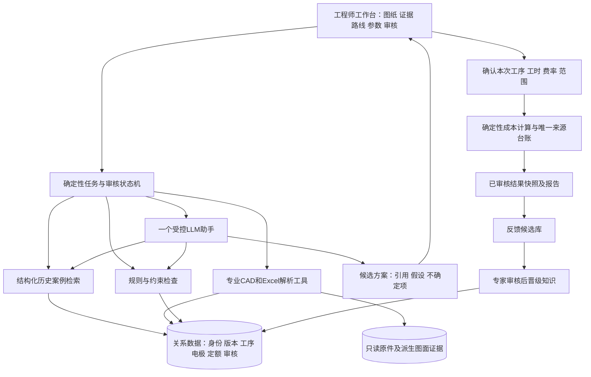

# Agent架构比较与推荐方案

日期：2026-10-15。设计对象：人工审核的加工成本辅助系统；本轮不实现Agent或调用甲方资料进行外部模型推理。

## 1. 推荐方案

**推荐方案A作为主架构：专业Python/CAD工具＋规则＋关系数据检索＋受控LLM辅助＋人工审核。** 对外可提供一个工具型助手入口，支持解释、检索和草案生成；批量处理、关键确认、计算及审批仍由明确的工作流控制，不由模型自行决定是否跳过。

方案B适合作为后续交互增强：在状态机限定范围内允许一个Agent选择只读检索工具。方案C当前不建议，四种专业职责可表现为同一工作流的工具和分析模板，无需四个自治Agent。此选择是针对当前需求的工程判断，不是已验证的模型性能结论。

公开工程资料区分预定义工作流与模型自主选择步骤，并建议从简单组合开始；本项目固定的证据、审核及核算步骤使方案A更便于控制。[工作流与Agent的原始工程说明](https://www.anthropic.com/engineering/building-effective-agents)

## 2. 三方案比较

| 维度 | A：确定性工作流＋LLM辅助 | B：单Agent＋专业工具 | C：多Agent协同 |
| --- | --- | --- | --- |
| 技术可行性 | 高；已有pipeline可复用，缺用户流程 | 高，但须限制工具、循环和写权限 | 技术上能搭建，不等于多角色提升工艺正确性 |
| 开发复杂度 | 中等，主攻证据/业务/审核 | 中等偏高，增加动态选择、恢复和状态一致性 | 高，增加跨Agent任务、冲突协调、共享状态 |
| 数据要求 | 当前样本＋最小规则/人工参数可启动 | 与A相同；还需工具选择与失败情境评价 | 基础数据缺口不减少；各角色还需独立评价和协调样例 |
| 建设成本 | 三者中最可控，按模块验收 | 在A工具基础上增加编排与回归成本 | 角色协议、重复调用和联合排错成本较高 |
| 运行成本 | 调用位置和次数可预先约束 | 由工具循环和上下文长度影响，需预算上限 | 多次上下文/交叉验证通常增加开销，不能假定成本固定 |
| 可维护性 | 规则和工具可单独回归，失败位置清晰 | 提示、工具描述与模型变更可能改变路径 | 版本组合更多，根因与责任边界更难定位 |
| 可解释性 | 关键证据及每步状态可确定保存 | 需记录实际调用链，解释不等于正确 | 多份理由可能互相重复，投票不能替代事实核对 |
| 落地难度 | 3/5，局部CAD/电极4/5 | 3–4/5，关键工具仍须确定性 | 4/5以上；不解决制造专业与数据瓶颈 |
| 适用阶段 | 原型和一期MVP | 工具稳定后的复杂交互 | 多条成熟业务线确有独立职责/并行需求后另评 |

本表比较的是责任与工程复杂度，不是厂商模型跑分。没有实测前不给出多Agent准确率增益或固定费用倍数。

## 3. 总体架构

模型输出不会直接写入已确认事实或覆盖核算参数。建议和原始事实分表/分状态；审核结果绑定输入、规则、费率及结果版本。

## 4. 确定性程序与LLM职责

| 必须由程序/明确规则完成 | 适合LLM辅助 | 必须保留人的裁决 |
| --- | --- | --- |
| 文件格式、哈希、只读原件、图元坐标与测量 | 将已提取制造要求整理成可读摘要 | 材料、公差或图号冲突的采用值 |
| 图号精确关联、字典映射、来源行顺序 | 根据确认属性选择检索条件、解释历史差异 | 历史案例是否可比、工序能否采用 |
| 电极来源发生唯一性、图结构和重复检测 | 对案例支持的候选路线提出修改建议 | 电极复用、放电归属、未知工序和机床能力 |
| 单位换算、费用公式、批量分摊和舍入 | 解释定额适用风险、整理人工待填问题 | 本次估时、费率、范围及核价结果确认 |
| 缺项检查、引用ID存在性、审核状态与重算 | 生成带引用的比较说明和报告草稿 | 共享规则晋级及正式业务报价审批 |

LLM不执行CAD精确测量，不决定特殊字体必然含义，不以自然语言心算代替金额计算，不把自己的置信分数当统计概率。

## 5. 工具与状态边界（设计接口，不是本轮开发）

| 工具职责 | 输入/输出要求 | 权限与校验 |
| --- | --- | --- |
| CAD证据读取 | 文件/版本/零件区域→原文、实体位置、候选属性 | 只读、范围限定、返回真实来源ID |
| 历史案例查询 | 模具类型、已确认属性、件号→案例及差异 | 模具隔离；严格关联/别名候选分开 |
| 路线与定额读取 | 案例ID→工序发生、源行、定额性质/单位状态 | 不合并连续相同工序，不将定额改名为实测 |
| 约束检查 | 候选工序/制造要求→冲突与待确认项 | 规则含版本及适用范围；无规则不假定通过 |
| 电极依赖查询 | 主体件号→支线、归属状态、唯一来源台账 | 汇总边与先后边分开；0与缺失分开 |
| 参考成本试算 | 本次确认的参数版本→金额/费用范围/缺失项 | 程序计算；假设试算标为草稿，不能自行批准 |
| 审核与导出 | 人工操作→新版本/审批/导出快照 | 模型无批准权限，修改触发受影响审批失效 |

限制工具最大循环、超时和模型调用预算；模型失败时仍可使用结构化查询、人工编辑和计算。自然语言“确认了”不能替代有身份的审核操作。引用校验须检查来源存在且确实支持该主张，不能只检查编号格式。

## 6. 是否需要这些技术

| 技术 | 一期选择 | 理由与边界 |
| --- | --- | --- |
| RAG/检索增强 | 建议轻量采用 | 先查结构化案例及字典，再把有权限的片段提供给模型；不是把全部CAD/Excel塞进上下文 |
| 向量数据库 | 不是前置 | 两套模具先用关系筛选、全文和少量向量索引即可；扩大库及检索评价证明收益后再选专用服务 |
| 关系数据库 | 需要 | 零件/版本、顺序工序、电极、定额、费率和审核属于明确关系；原型可用轻量数据库，MVP按并发选事务型服务 |
| 专业CAD解析库 | 必须 | 复用已验证DXF读取与转换流程，制造语义另审；LLM不能替代文件解码 |
| 三维几何内核 | 有条件引入 | 真正读取STEP拓扑、体积/表面时需要专业内核；只做文件登记和人工对应不必前置，精确3D扩展独立验收 |
| 模型微调 | 一期不需要 | 当前标签量与性质不支持可靠专用工艺/实际工时模型；先做工具、检索、规则和人工闭环 |
| 图数据库 | 当前非必需 | 电极图可由关系表和依赖边表达；先保证语义和唯一来源，不因图形展示就引入独立图数据库 |
| 多Agent框架 | 非必需 | 一个助手加明确任务状态即可；框架选择不应扩大自主权限或替代业务规则 |
| 私有模型/嵌入 | 按授权和运行环境验证 | 可用经授权的现成模型，不等于训练；模型质量、延迟、硬件与许可需本地试验，不假定免费或无需GPU |

检索增强的原始研究将生成模型与外部检索记忆结合，本项目采用“先取有依据资料、再组织回答”的思路。这里不要求复现论文训练，也不据此声称制造推理已经可靠。[RAG原始论文](https://arxiv.org/abs/2005.11401)

## 7. RAG的具体组织与失败处理

索引按冲压/注塑、原始/审核案例、图纸版本、材料及工序范围分组。精确件号与有确认规则的别名优先走关系查询；相似检索使用已确认属性和全文，可选语义召回。检索结果附案例差异、来源和适用边界，排序不是工艺适用概率。

LLM输出区分：引用的原始事实、历史做法、当前建议、人工输入假设、缺失项。未检索到合适案例时应说明，并提供人工建路线入口；不能为了回答完整生成“历史定额”。区间来自真实可比案例或人工参数，不能伪装成模型误差分布。

## 8. 人工反馈与知识治理

保存输入快照、调用链、证据ID、建议及用户修改；定额、本次暂估和实际报工分别保存。原始数据层不被编辑，审核只新增映射/采用值及新版本。个案修改先入候选库；共享规则需制造负责人确认有效范围、批准版本并有撤回机制。

重复来源记录与多页建立唯一业务引用，避免同一工序因两份CAD导出、两次检索或两个Agent被算两次。正式核价确认不能仅靠点击“全部接受”，应展示费用范围、关键采用值与未决项。

## 9. 本地部署与本轮资料处理边界

本轮只在本地读取内部资料。公开资料查询仅访问通用RAG与Agent设计文献，未发送甲方内容。后续原型默认内部CAD解析、内部存储及经甲方批准的模型端点；若只能使用外部服务，必须另行明确数据授权和传输范围，当前不视为已授权外发。

一期间仍需文件访问隔离、角色权限、结果审核记录、备份及恢复。LLM接触的图纸文字和历史说明均作为业务数据，不能被其中指令改变工具权限或绕过审批。外部系统写入、生产下发与采购批准不在本方案默认工具范围内。

## 10. 原型需要验证的设计假设

J1：一名助手加检索可减少工程师查找步骤；J2：带证据候选比空白手编节省净审核时间；J3：本地模型足以进行有引用摘要与有限候选；J4：按当前模板可以提供可用的图面定位。均须试用验证，失败时可缩减为结构化工具＋人工，不改变基础数据事实。
