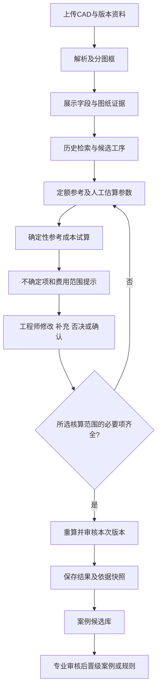

# 人机协同模式下的项目可行性重新评估

日期：2026-10-15。范围：需求与数据评审、方案设计、内部估算；本轮未开发系统、训练模型或修改原始资料。

## 1. 明确结论

**现有资料足够启动“人工审核的AI加工成本辅助评估系统”，可以做有实际业务用途的原型及限定范围商业MVP。一期整体难度为3/5，公差解释、图面证据与电极归属的局部难度为4/5。** 这是工程判断，尚非经用户试用验证的产品效果。

一期可覆盖图纸导入与信息候选、图号/多页整理、历史工艺及定额查询、案例筛选、候选工序说明、主体/电极依赖展示、人工调整，以及在参数确认后的参考成本试算。无需等待大规模训练数据或自研工时预测模型。

这不改变原判断：自动优选新工艺、准确预测实际工时、可靠完成任意2D到3D重建、无人审核报价，仍未获得数据和效果证据。当前可启动的依据是业务允许“建议—核对—补录—确认”，不是数据被重新判为完整。

## 2. 阅读范围与证据等级

完整读取原始需求PDF（含第3页图示）、两份Word正文/表格/页眉页脚、6页工艺PPT及原有说明；阅读四份分析报告，并复核关联JSON、定额统计和F20A台账。两份Word逐项意见见 [Word方案审查](word_proposal_review_comments.md)，原件保留。

| 等级 | 含义 | 本项目示例 |
| --- | --- | --- |
| F：已验证数据事实 | 本地解析或来源记录可复核；不等于甲方已审核金标准 | 171/179严格编号关联、Excel原始定额、字典说明 |
| S：甲方陈述 | 来源文档明确描述，未必已独立验证 | 公差变更价差700元；PPT描述图号对应及F20A支线 |
| J：工程判断 | 基于事实与产品边界提出的方案 | 采用受控工作流、不微调、一期难度3/5 |
| V：待验证假设 | 需要专家、样本或原型试验确认 | 候选路线能提高核价效率、相似案例确实可比 |

### 2.1 数据事实及其限制

| 编号 | 事实/出处 | 可以支持什么 | 不能由此证明什么 |
| --- | --- | --- | --- |
| E01 | [DXF报告](dxf_deep_analysis.md)：初始7个DXF可读；CMY195框、179图号 | 文件/图框组织、工程文字提取 | 全部公差语义完整；所有后续CAD格式都兼容 |
| E02 | 同报告：材料、硬度、公差及技术说明原文可提取；gdt字体/尺度存在核对项 | 带原图定位的信息候选 | 无人审核的制造要求理解正确率 |
| E03 | [制造数据报告](manufacturing_data_analysis.md)：CMY783工序、179主体+9电极；SMX151工序、18主体+26电极 | 初始案例库、原件号查询 | 197个主体是独立跨模具训练样本 |
| E04 | [关联报告](cad_process_matching_report.md)：CMY严格171/179；明细口径177/179；图号或明细178/179，其中1冲突 | 透明的编号关联与异常处理 | 178件都可直接放行，或图纸/工艺版本已一致 |
| E05 | 同报告：SMX严格17/18；星号待确认；旧6组包含在新18组内 | 去重后的主体案例组织 | 共有24个独立注塑主体样本 |
| E06 | 分类表37代码，当前CMY23种及SMX15种所用代码全部可映射 | 工序名称解释、规则词典起点 | 所有路线适用于新件；末7项类别已明确 |
| E07 | 两表列名为工时定额，各9条零值，数值最大72；全表单位无独立列 | 历史定额查询与异常提示 | 已取得实测工时；零值表示无需加工；72必然错误 |
| E08 | F20A原行28–31、101–105；10.5+3.7+5.5=19.7，9个唯一来源行 | 主体/电极支线及计数校验 | 主体实际历时、已确认成本归属或电极复用规则 |
| E09 | SMX18个主体有同名2D/3D；未验证三维几何和版次 | 对应候选与人工确认入口 | 所有STEP可用、三维尺寸/公差完备 |
| E10 | D21A/D21AG、S33A*、M20A*；M24B=1=3仅CNC3缺EDM2 | 具体异常清单与审核样例 | 可自动改编号、补工序或补零 |

本轮依据包括 `data/processed/manufacturing/analysis_summary.json`、`cad_process_matches.json`、`SMX0100-F20A_dependency.json`、`process_dictionary.json`、`presentation.json`。本轮不重写这些分析产物，也不改变原有覆盖率。

## 3. 对甲方核心诉求的重新定义

原需求的业务目标是批量分析图纸并评估成本，PDF提出的多个Agent、缺3D先重建及90%匹配，是实现设想，不是已确认技术验收条件。客户最迫切的问题是关键制造要求变更被遗漏。

建议一期目标定义为：**工程师在同一工作台内核对图纸证据，快速找到可比历史路线和定额，修改候选工序及核价参数，生成有范围、有依据、有审核记录的参考成本。** AI不担任正式报价批准人。

四个业务层级分开：原始工程事实、历史记录、本次AI建议、工程师审核结果。原始资料只读；人工修正写入新版本，不覆盖历史事实。

## 4. 当前数据是否够用：十项回答

| 问题 | 重新评估 |
| --- | --- |
| 1. 能否支撑可用辅助原型？ | 能启动。已有CAD证据、工序字典和逐件路线可形成分析工作台；实际有用性须由工程师试用评价 |
| 2. 推荐/提示/确认哪些可先做？ | 字段候选、编号匹配、历史路线、定额原文、零值/冲突提示、电极图、基于已选案例的候选及差异解释；新件缺证据时允许停在人工填写 |
| 3. 哪些不用训练？ | CAD读取、字典映射、图号检索、规则筛选、原行序、依赖台账、人工参数成本算术、审批与导出。候选解释可用通用LLM加检索 |
| 4. 能否建立初始制造知识库？ | 能建立客户范围内的“历史案例＋代码字典＋经审核规则”库。它不是通用制造知识真值库；原始路线、推断及审核知识须分区 |
| 5. 两套模具规模的限制？ | 对本样本历史查询足够；对相似检索仅有有限候选，对新材料/形状/设备可能没有参考。不能证明跨模具工艺或实际工时泛化 |
| 6. 定额可否先做参考？ | 可以展示原文与来源，标记为定额；全表单位未确认时不自动用于工时换算。工程师可针对本次确认单位与适用性，或另填本次估算 |
| 7. 无实际工时和费率时能做多远？ | 可查询定额、比较已确认的同口径记录、提出人工待填项、展示公式与费用范围。无费率不能生成有依据的金额，缺项不能默认为0 |
| 8. 工程师填写参数后能否算？ | 可以。工序/工时/单位/费率/数量及电极归属经确认，程序即可计算参考加工费；材料、外协等可手填或明确排除。参考成本不等于商业报价 |
| 9. 哪些缺口可以人工补？ | 本次材料/公差确认、图号别名及版本绑定、选定工序/顺序、本次估算工时/区间、费率/数量/材料外协费用、归属与核算范围。均需署名、理由和有效期 |
| 10. 哪些必须新增历史数据？ | 真实工时预测的报工与加工条件；跨模具泛化的独立案例；版本检测效果的真实旧新版对照；成本预测验证的独立实际成本。手填假设不能替代这些证据 |

缺少完整历史数据不是所有辅助功能的启动阻碍。没有确认的条件也不能因为界面可编辑而转成“AI已知”。

## 5. 功能边界与一期价值

18项模块详见 [业务支持矩阵](business_requirement_support_matrix.md)。推荐一期包含：受限CAD接入、原图证据、多零件整理、历史检索、候选工艺/定额参考、电极审核、参数化成本、人工确认、反馈和导出。2D/3D先做文件及人工对应；版本检测先支持人工指定对比对，业务效果验收待旧新样本；自动完整3D重建暂不纳入。

一期不要求专用模型训练，不承诺覆盖未知零件全部工序。工程师可以在无匹配案例时新建路线，系统提供词典、检查及计算帮助，不能把空库检索失败伪装成可靠推荐。

## 6. 人工审核流程及控制点

核算范围须显式选定，例如“只算加工费用、材料费不含”。若所选范围缺必要参数，可保留部分小计和待补清单，不能显示为完整总成本。草稿可导出，但明显标注未审核、假设与缺失项。关键材料/公差/版本无法确认时，可继续调查和手工编辑，不能转为已审核的核价结论。

### 6.1 字段与任务状态

每字段至少保留原始值、AI候选、当前采用值、来源位置、来源类型、审核状态、确认人和时间。状态包括“未提取/有证据候选/人工输入假设/已确认/冲突/否决”；缺失和0分开。

任务状态为草稿、待补充、待审核、已审核、已作废。修改工时、费率、费用范围、材料或公差等上游条件后，使受影响的核算与审核状态失效，生成新结果版本；不静默沿用旧批准金额。

### 6.2 审核能降低与不能降低的难度

| 可降低 | 不能降低 |
| --- | --- |
| 不必一次给出唯一正确路线；可让专家选候选、补工序 | 确保候选引用真实存在，不能制造来源 |
| 不必先训练实际工时模型；可引用定额或人工估算 | 单位、数量、来源发生次数、金额计算必须正确 |
| 不必自动认定材料、公差与二维/三维关系 | 原图、实体、Excel行及版本定位必须可核对 |
| 可以限定输入模板和零件类别，失败转人工 | 文件隔离、审核身份、历史不可篡改及权限不能省略 |
| 部分缺数据由工程师为本次输入 | 泛化、预测准确性不能通过点击确认被“证明” |

审核也会增加界面、差异记录、审批状态、重算、操作培训和专家参与的成本；不是将5级任务简单变成1级。

## 7. 从人工反馈到后续样本

留存原始输入快照、图纸/工艺版本、检索候选和排序、规则版本、AI输出、本次采纳/修改/否决、修改理由、专业审核和后续实测。对“人工暂估工时”“工程师审定定额”“实际报工”使用不同标签，不能互相升级。

个案确认先进入候选案例库，只有明确适用范围且通过知识审核才晋级共享案例/规则。人工修改不是天然正确标签；记录审核争议，按模具、家族、版本隔离后续训练与测试，保留从未用于调试的验证样本。规则晋级应版本化并能撤回，不能将一次修改自动覆盖所有零件。

## 8. 参考成本能够成立的最小条件

无需等到实际工时预测可靠，但本次采用的时间口径必须清楚。所选范围内的基础计算关系可为：

批量加工费用＝Σ（已确认单件工序运行时间×数量×适用费率）＋批次准备费用＋已确认外协等费用。

单件参考成本＝批量已含费用÷有效数量；材料费用按本次确认的单件/批次口径另计。设备费率是否已经含人工、热处理按件/炉/重量计价、电极是否复用，均按确认规则计算，不能简单全部使用小时乘费率。

演示假设（不来自甲方生产事实）：运行2小时/件、150元/小时、10件，批次准备1小时×100元/小时，材料80元/件，则所选范围批量3900元、单件390元。只证明公式可算，不证明这些工时或价格适用于真实零件。

对范围估算允许用明确的上下限参数做情景计算；没有误差数据时不能标称95%置信区间或预测精度。缺费率时只展示时间及待填项，不虚构市场单价。

## 9. 验收重心变化

从“AI独立报价准确率”转为：来源定位正确、单位与公式正确、关键冲突显式呈现、重复步骤不漏计/双计、工程师可修改并重算、结果与审核版本一致，以及试用中是否减少查找/录入时间和遗漏。

候选有用性需专家评审；效率提升需在相同任务上比较人工流程与辅助流程，包括审核时间。没有试用数据就不预先承诺节约比例。版本检测的漏检评价需要真实对照；工时预测误差只在取得独立实际标签后评价。

## 10. 启动决策

建议启动，采用 [架构比较](agent_architecture_comparison.md) 推荐的“确定性工作流＋一个受控工具型助手＋人工审核”，以 [范围估算](mvp_scope_and_estimation.md) 划定交付。最关键甲方支持不是先提供完美大数据，而是指定工艺/核价负责人、确认定额单位与核算范围、为试点提供或现场填写费率、审核关键公差/身份/电极问题，并参与试用。

正式预测模型及无人审核报价继续保留独立门槛。本次结论是产品定位变化带来的可开发范围扩大，不是对原数据和风险结论的推翻。
