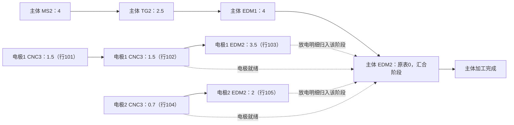

# 历史加工工艺与工时数据分析

分析日期：2026-10-15（北京时间）。仅本地数据分析，未调用外部大模型，未训练模型或开发 Agent。

## 业务说明与证据

完整读取《机加图档工艺工时说明》6页的文字、表格、图片及连接关系。第3页明确：CMY1000A 为冲压模具、仅有2D；SMX0100 为注塑模具，说明称2D均有对应3D。此前将大图一并视作塑胶模具样本的理解应据此修正。两种模具后续分别验证和建模。
第4页明确图号与件号对应、同件号工序自上至下排列；第5页给出 F20A 主体与两个铜电极的依赖及示例小时数。原始说明、各页完整内容与连接标识存于 `presentation.json`，图片保存在结构化结果子目录。

## 文件、工作表与字段

### CMY1000A（冲压模具）

来源：`/home/gxl/code/cad-cost-estimation/data/raw/manufacturing/CMY1000A-详细工艺工时.xls`；工作表 `模具进度查询`；物理行数 785，表头在第2行，有效记录 783。第1行为空行。

原始字段：['模具内部编号', '件号', '零件名称', '工序名称', '工时定额']。

存储类型分布：{'模具内部编号': {'text': 783}, '件号': {'text': 783}, '零件名称': {'text': 783}, '工序名称': {'text': 783}, '工时定额': {'text': 783}}。所有工时原文保持不变，单独产生数值解析结果。

各原始字段空值数：{'模具内部编号': 0, '件号': 0, '零件名称': 0, '工序名称': 0, '工时定额': 0}；模具内部编号分布：{'CMY1000A': 783}。

### SMX0100（注塑模具）

来源：`/home/gxl/code/cad-cost-estimation/data/raw/manufacturing/SMX0100-详细工艺工时.xls`；工作表 `模具进度查询`；物理行数 153，表头在第2行，有效记录 151。第1行为空行。

原始字段：['模具内部编号', '件号', '零件名称', '工序名称', '工时定额']。

存储类型分布：{'模具内部编号': {'text': 151}, '件号': {'text': 151}, '零件名称': {'text': 151}, '工序名称': {'text': 151}, '工时定额': {'text': 151}}。所有工时原文保持不变，单独产生数值解析结果。

各原始字段空值数：{'模具内部编号': 0, '件号': 0, '零件名称': 0, '工序名称': 0, '工时定额': 0}；模具内部编号分布：{'SMX0100': 151}。

| 模具 | 工序记录 | 所有件号 | 主体件号 | 电极件号 | 不同工序代码 | 一件多工序 |
| --- | --- | --- | --- | --- | --- | --- |
| CMY1000A | 783 | 188 | 179 | 9 | 23 | 188 |
| SMX0100 | 151 | 44 | 18 | 26 | 15 | 43 |

## 工艺分类字典与覆盖

来源：`/home/gxl/code/cad-cost-estimation/data/raw/manufacturing/模具加工工艺分类.xlsx`，工作表 `机加工(工艺分类)`；41个物理行、5列，无常规列标题；第4至40行有 37 个代码说明。

A/B列类别仅按原始合并单元格锚点解析，不将空白行按前一工种填充。第34至40行的类别单元格为空，YJ、DG、HH、PP、JY、DD、RCL 虽有准确代码描述，但类别未给出，不能归入“放电”。CK1/CK2 位于“慢丝/MS”原始分组中，也不自行重分类。

| 模具 | 已映射记录/全部 | 记录覆盖率 | 已映射代码/全部 | 未映射代码 |
| --- | --- | --- | --- | --- |
| CMY1000A | 783/783 | 100.00% | 23/23 | [] |
| SMX0100 | 151/151 | 100.00% | 15/15 | [] |

字典中的准确名称如下；这些是客户分类，不代表已验证设备、能力或成本费率。

| 原始行 | 类别 | 类别代码 | 工序代码 | 原始说明 |
| --- | --- | --- | --- | --- |
| 4 | 大水磨 | DSM | DSM1 | 粗加工 |
| 5 | 大水磨 | DSM | DSM2 | 精加工 |
| 6 | 光曲磨 | PG | PG1 | 开粗（异形冲子） |
| 7 | 光曲磨 | PG | PG2 | 精加工 |
| 8 | 坐标磨 | JG | JG | 坐标磨精加工 |
| 9 | 磨床 | TG | TG1 | 下料 |
| 10 | 磨床 | TG | TG2 | 普通钢材一般成型加工 |
| 11 | 磨床 | TG | TG3 | 普通钢材复杂成型加工 |
| 12 | 磨床 | TG | TG5 | 钨钢一般成型加工 |
| 13 | 磨床 | TG | TG6 | 钨钢复杂成型加工 |
| 14 | 数控磨床 | STG | STG | 数控磨床加工（塑模镶件主体/多件冲子加工） |
| 15 | 加工中心 | CNC | CNC1 | 软料加工，热处理前模板.零件 |
| 16 | 加工中心 | CNC | CNC2 | 石墨电极 |
| 17 | 加工中心 | CNC | CNC3 | 铜电极 |
| 18 | 加工中心 | CNC | CNC4 | 塑模主体开粗（热处理前） |
| 19 | 加工中心 | CNC | CNC5 | 硬料精加工 |
| 20 | 铣床 | XC | XC | 软料加工 |
| 21 | 线切割 | EW | EW1 | 下料 |
| 22 | 线切割 | EW | EW2 | 模板加工 |
| 23 | 线切割 | EW | EW3 | 精加工（导面/成型/割孔加工） |
| 24 | 线切割 | EW | EW4 | 中丝精加工 |
| 25 | 慢丝 | MS | CK1 | Φ0.5以下小孔 |
| 26 | 慢丝 | MS | CK2 | >0.5的孔 |
| 27 | 慢丝 | MS | MS1 | 开粗供精加工 |
| 28 | 慢丝 | MS | MS2 | 精加工 |
| 29 | 慢丝 | MS | MS6 | 油割加工（R0.12以下MS6加工） |
| 30 | 慢丝 | MS | MS7 | 油割加工（Φ0.07线加工） |
| 31 | 放电 | EDM | EDM1 | 简单加工 |
| 32 | 放电 | EDM | EDM2 | 精加工（CNC电极成型加工） |
| 33 | 放电 | EDM | EDM4 | 螺牙加工（硬料） |
| 34 | None | None | YJ | 阳极（铝合金） |
| 35 | None | None | DG | 镀铬（S45C） |
| 36 | None | None | HH | 回火（仅限冲模模板） |
| 37 | None | None | PP | 抛光 |
| 38 | None | None | JY | 检验 |
| 39 | None | None | DD | 电镀 |
| 40 | None | None | RCL | 热处理 |

### 工序代码分布

- CMY1000A：{'CNC1': 12, 'CNC3': 9, 'CNC5': 4, 'DSM1': 24, 'DSM2': 18, 'EDM1': 38, 'EDM2': 18, 'EDM4': 2, 'EW1': 109, 'EW2': 12, 'EW3': 92, 'HH': 12, 'JG': 6, 'MS1': 14, 'MS2': 55, 'MS6': 16, 'PG2': 78, 'RCL': 21, 'STG': 8, 'TG2': 86, 'TG5': 129, 'TG6': 5, 'XC': 15}。
- SMX0100：{'CNC1': 6, 'CNC3': 26, 'CNC5': 8, 'DSM1': 9, 'DSM2': 8, 'EDM1': 2, 'EDM2': 34, 'EW1': 1, 'EW3': 13, 'JG': 3, 'MS2': 12, 'PG2': 1, 'RCL': 3, 'TG2': 23, 'TG3': 2}。

## 工时性质、分布与异常

**两个Excel的列名均为“工时定额”，不是实测标签。未提供报工时间、开停机记录、人员、设备、批量或采集方式，因此无法确认其为实际加工工时。** 原需求PDF提到可提供精准工时，不等于本次交付表已证实具备该属性。
表内没有单位列；PPT第5页 F20A 案例明确使用 h。全表是否统一为小时、单件还是批次、是否含准备和检验、热处理是否为等待周期，仍需甲方确认。以下全表统计均为原始定额数值，不折算为实际小时或成本。

| 模具 | 有效数值 | 空/非数值 | 零值 | 负值 | 最小 | Q1 | 中位 | Q3 | P95 | 最大 | 原始数值合计 |
| --- | --- | --- | --- | --- | --- | --- | --- | --- | --- | --- | --- |
| CMY1000A | 783 | 0 | 9 | 0 | 0.0 | 0.5 | 0.8 | 1.8 | 8.0 | 72.0 | 2790.2 |
| SMX0100 | 151 | 0 | 9 | 0 | 0.0 | 1.0 | 1.5 | 2.7 | 5.75 | 72.0 | 511.3 |

异常候选使用全表与同工序内 Q3+1.5×IQR 上界（同工序至少4条）。不剔除或修正记录；长周期热处理、大型零件、准备时间都可能产生高值。完整异常清单及逐工序分布见 JSON。

### CMY1000A 异常及重复记录

零值 9 条；统计高值候选 141 条；完全相同五字段的额外出现次数 18。重复行保留为独立工序发生，不能默认删除。

| 来源行 | 件号 | 代码 | 定额原文 | 标记 |
| --- | --- | --- | --- | --- |
| 336 | CMY1000A-D31A | EDM2 | 0 | ['zero'] |
| 349 | CMY1000A-S31B | EDM2 | 0 | ['zero'] |
| 422 | CMY1000A-D35C-E | EDM2 | 0 | ['zero'] |
| 468 | CMY1000A-S35A-D | EDM2 | 0 | ['zero'] |
| 502 | CMY1000A-D36C | EDM2 | 0 | ['zero'] |
| 712 | CMY1000A-D38C | EDM2 | 0 | ['zero'] |
| 738 | CMY1000A-S38B | EDM2 | 0 | ['zero'] |
| 742 | CMY1000A-D39A | EDM2 | 0 | ['zero'] |
| 747 | CMY1000A-D39B | EDM2 | 0 | ['zero'] |

高值候选示例（至多8条）：

| 来源行 | 件号 | 代码 | 定额原文 | 标记 |
| --- | --- | --- | --- | --- |
| 92 | CMY1000A-P02A | RCL | 72 | ['above_global_IQR_fence'] |
| 99 | CMY1000A-P02B | RCL | 72 | ['above_global_IQR_fence'] |
| 107 | CMY1000A-P03A | RCL | 72 | ['above_global_IQR_fence'] |
| 117 | CMY1000A-P03B | RCL | 72 | ['above_global_IQR_fence'] |
| 127 | CMY1000A-S02A | RCL | 72 | ['above_global_IQR_fence'] |
| 135 | CMY1000A-S02B | RCL | 72 | ['above_global_IQR_fence'] |
| 142 | CMY1000A-S01A | RCL | 72 | ['above_global_IQR_fence'] |
| 153 | CMY1000A-S01B | RCL | 72 | ['above_global_IQR_fence'] |
### SMX0100 异常及重复记录

零值 9 条；统计高值候选 13 条；完全相同五字段的额外出现次数 10。重复行保留为独立工序发生，不能默认删除。

| 来源行 | 件号 | 代码 | 定额原文 | 标记 |
| --- | --- | --- | --- | --- |
| 31 | SMX0100-F20A | EDM2 | 0 | ['zero'] |
| 34 | SMX0100-F21A | EDM2 | 0 | ['zero'] |
| 37 | SMX0100-F22A | EDM2 | 0 | ['zero'] |
| 59 | SMX0100-M20A* | EDM2 | 0 | ['zero'] |
| 63 | SMX0100-M21A | EDM2 | 0 | ['zero'] |
| 67 | SMX0100-M21B | EDM2 | 0 | ['zero'] |
| 83 | SMX0100-M24B | EDM2 | 0 | ['zero'] |
| 90 | SMX0100-M25A | EDM2 | 0 | ['zero'] |
| 97 | SMX0100-M26A | EDM2 | 0 | ['zero'] |

高值候选示例（至多8条）：

| 来源行 | 件号 | 代码 | 定额原文 | 标记 |
| --- | --- | --- | --- | --- |
| 11 | SMX0100-E02A | RCL | 72 | ['above_global_IQR_fence'] |
| 17 | SMX0100-F03B | RCL | 72 | ['above_global_IQR_fence'] |
| 48 | SMX0100-M03B | RCL | 72 | ['above_global_IQR_fence'] |
| 55 | SMX0100-M20A* | MS2 | 15 | ['above_global_IQR_fence', 'above_process_IQR_fence'] |
| 64 | SMX0100-M21B | MS2 | 10 | ['above_global_IQR_fence', 'above_process_IQR_fence'] |
| 5 | SMX0100-E01A | EW3 | 7 | ['above_global_IQR_fence', 'above_process_IQR_fence'] |
| 57 | SMX0100-M20A* | CNC5 | 7 | ['above_global_IQR_fence', 'above_process_IQR_fence'] |
| 40 | SMX0100-M02B | EW3 | 6 | ['above_global_IQR_fence', 'above_process_IQR_fence'] |

## 原始工序顺序与典型完整路线

按PPT第4页说明，按件号保留同工作表原始行序。工序重复、回到同一工种均保留，不按代码排序、不按相同字段去重。恢复的是历史记录路线，未获得机器排程、跨件并行顺序或每次加工的特征位置。

### CMY1000A-D20C

来源：`/home/gxl/code/cad-cost-estimation/data/raw/manufacturing/CMY1000A-详细工艺工时.xls` / `模具进度查询`；原始定额数值合计 2.9。

| 顺序 | 来源行 | 工序代码 | 字典准确说明 | 工时定额原文 |
| --- | --- | --- | --- | --- |
| 1 | 3 | EW1 | 下料 | 0.7 |
| 2 | 4 | TG2 | 普通钢材一般成型加工 | 0.3 |
| 3 | 5 | EW3 | 精加工（导面/成型/割孔加工） | 0.7 |
| 4 | 6 | EW3 | 精加工（导面/成型/割孔加工） | 0.7 |
| 5 | 7 | TG2 | 普通钢材一般成型加工 | 0.5 |
### SMX0100-E01A

来源：`/home/gxl/code/cad-cost-estimation/data/raw/manufacturing/SMX0100-详细工艺工时.xls` / `模具进度查询`；原始定额数值合计 16.5。

| 顺序 | 来源行 | 工序代码 | 字典准确说明 | 工时定额原文 |
| --- | --- | --- | --- | --- |
| 1 | 3 | DSM1 | 粗加工 | 1 |
| 2 | 4 | CNC1 | 软料加工，热处理前模板.零件 | 3.5 |
| 3 | 5 | EW3 | 精加工（导面/成型/割孔加工） | 7 |
| 4 | 6 | DSM2 | 精加工 | 2.5 |
| 5 | 7 | JG | 坐标磨精加工 | 1.5 |
| 6 | 8 | CNC5 | 硬料精加工 | 1 |
### SMX0100-F20A

来源：`/home/gxl/code/cad-cost-estimation/data/raw/manufacturing/SMX0100-详细工艺工时.xls` / `模具进度查询`；原始定额数值合计 10.5。

| 顺序 | 来源行 | 工序代码 | 字典准确说明 | 工时定额原文 |
| --- | --- | --- | --- | --- |
| 1 | 28 | MS2 | 精加工 | 4 |
| 2 | 29 | TG2 | 普通钢材一般成型加工 | 2.5 |
| 3 | 30 | EDM1 | 简单加工 | 4 |
| 4 | 31 | EDM2 | 精加工（CNC电极成型加工） | 0 |

CMY1000A：全部路线可按单一工作表原行序恢复：True；非连续行件号：[]。

SMX0100：全部路线可按单一工作表原行序恢复：True；非连续行件号：[]。

## 电极与放电依赖验证

F20A 主体 Excel 行28–31：MS2(4)→TG2(2.5)→EDM1(4)→EDM2(0)。电极1行101–103：CNC3(1.5)→CNC3(1.5)→EDM2(3.5)；电极2行104–105：CNC3(0.7)→EDM2(2)。PPT第5页给出相同编号、两段1.5h加工及3.5h/2.0h放电时间，支持该案例的支线解释。

实线表示原始件号内顺序；虚线分别表示电极就绪条件和放电明细归属，不将汇总关系当作工序先后。两个放电明细的相互顺序、与主体EDM1的具体开工约束及电极复用均待工艺工程师确认。

按不同来源行计一次：主体数值小计 10.5，电极CNC加工 3.7，电极放电 5.5，合计 19.7（PPT该例使用小时）；来源行 9 条，重复计入 0 条。

**19.7 是本案例原始定额按来源行去重后的工作量合计，不是实际完工时长或确认的主体成本。** 若另外将5.5放电小计回填主体EDM2后再加支线，会重复计时；本次不回填原始0、不决定成本归属。两条1.5 CNC3是PPT支持的两次发生，保持独立。
其他“父件号=...”依赖只生成编号前缀候选，不将后缀数字解释为数量、材料或电极次数；也不将F20A的解释未经审核推广到所有零件。

### 其他电极支线完整性检查

| 电极件号 | 有制造记录 | 有放电记录 | 原始行 |
| --- | --- | --- | --- |
| SMX0100-M24B=1=3 | True | False | [153] |

缺少某类记录可能涉及电极复用、资料缺失或其他归属方式；不能填零、复制其他件工时或自动补工序。完整候选关系与缺口见 electrode_dependencies.json。

## 待甲方确认

1. 两份表的工时定额由谁编制、是否经过审核？能否提供实际报工及设备记录，与定额分列？
2. 全表单位、单件/批次口径、准备/换刀/装夹/检验/等待的包含范围是什么？
3. 主体EDM2为0是否为汇总占位？支线EDM2如何归属主体、是否包含其他准备工作？
4. 星号含义、电极后缀规则、重复工序的具体加工内容，以及仅CNC3而无EDM2的支线如何解释？
5. 热处理72等长值是设备占用、人工工时还是周期？分类表末7项的类别如何定义？
6. 提供图纸版本、工艺版本、数量、毛坯、设备能力、费率与有效期，确认冲压/注塑的独立核价规则。

结构化结果位于 `data/processed/manufacturing/`：原始工作表、工序记录、路线、统计、CAD证据、关联明细、电极图和输入完整性清单均保留来源。
